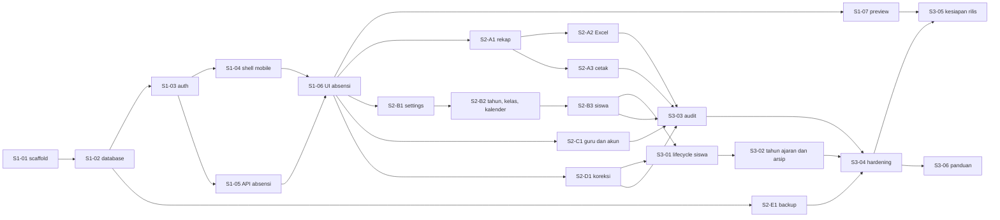

# Implementation Plan

## Sistem Manajemen Siswa, Guru, dan Absensi SD

| Atribut | Nilai |
|---|---|
| Versi | 2.0 |
| Tanggal | 6 Oktober 2026 |
| Status | Revisi vertical slice disetujui Toku; implementasi aplikasi belum dimulai |
| Dasar produk | [PRD v1.3](PRD.md) |
| Dasar teknis | [Technical Reference v1.2](TECHNICAL_REFERENCE.md) |
| Pelacakan pelaksanaan | [Execution Log](IMPLEMENTATION_LOG.md) |
| Prompt pelaksana | [Agent Prompt](AGENT_PROMPT.md) |
| Target | Satu sekolah, enam kelas, sekitar 60 siswa, dua guru |

## 1. Hasil yang akan diserahkan

Aplikasi web untuk manajemen siswa, guru, kelas dan kalender; absensi sekali sehari; koreksi dengan riwayat; rekap Excel dan cetak. Guru cukup menandai siswa yang tidak hadir, memastikan sisanya hadir, lalu mengonfirmasi penyimpanan. Penggunaan HP dan tablet menjadi prioritas sejak alur pertama.

Pengerjaan memakai vertical slice. Slice 1 menghasilkan alur absensi satu kelas yang bisa dicoba guru di HP-nya sendiri dengan data contoh. Slice 2 menambahkan rekap bulanan sebagai nilai utama bagi sekolah, bersama pengelolaan data, akun guru, koreksi dan backup yang dikerjakan paralel. Slice 3 melengkapi riwayat penempatan, operasi tahun ajaran, audit, hardening dan kesiapan rilis. LKPD dan adapter SIKL memakai rencana terpisah sesudah evaluasi produk inti.

### 1.1 Perubahan dari plan v1.0

| Perubahan | Alasan |
|---|---|
| 25 paket berurutan diganti 3 slice dengan dependensi eksplisit dan lane paralel | Hasil pertama yang bisa dicoba muncul lebih awal; rekap tidak lagi menunggu manajemen guru dan kalender |
| Schema inti tetap dibuat di S1-02, tetapi fixture besar dan uji balapan dipindah ke task fiturnya | Lane paralel tidak bentrok migrasi; fondasi tetap ringan |
| `rosterRevision` dihapus | Validasi himpunan roster di bawah class lock sudah menolak roster yang berubah, tanpa 409 palsu |
| `expectedConfigVersion` dan shared lock config pada mutasi dihapus | Tanggal kerja eksplisit dan batas hari ini divalidasi server saat commit |
| `mutation_receipts` ditunda ke backlog | unique(class,date), expectedVersion dan no-op berbasis state sudah mencegah duplikasi |
| Satu akun per orang; admin adalah peran pada akun guru | Keputusan Toku (Q-01 revisi) |
| Penanda Berubah setelah ekspor terakhir | Keputusan Toku (Q-11); tanpa kunci bulan |
| Backup otomatis terjadwal | Backup manual harian rawan terlewat |
| Komponen mobile dibuat sebelum form master | Form pertama langsung memakai komponen sentuh |
| Preview dengan data sintetis sejak M1 di branch Neon `development` | Guru mencoba di perangkat sendiri sebelum fitur lain dibangun |

## 2. Keputusan yang sudah ditetapkan

| Topik | Keputusan | Implikasi pekerjaan |
|---|---|---|
| Admin | Satu akun per orang; guru yang ditunjuk memakai akunnya sendiri dengan peran admin | Bootstrap aman; admin aktif terakhir tidak boleh dinonaktifkan atau diturunkan |
| Config sekolah | Nama, lokasi, timezone dapat diatur melalui tabel school_config | Form admin, validasi, version form, audit |
| Kalender | Tahun ajaran, weekdays, libur/hari tambahan configurable | Tidak hardcode hari sekolah; setup sebelum absensi |
| Akses kelas | Semua guru aktif mengakses semua kelas | Assignment tiga kelas utama hanya mengatur urutan |
| Terlambat | Koreksi menjadi Hadir; alasan tersimpan | Tidak menambah status atau jadwal per pelajaran |
| Stack | Next.js/TypeScript, Better Auth (di dalam aplikasi), Drizzle, pg, Neon; Vercel | Satu deployable, transaksi SQL dan role guards pada server |
| Hosting | Vercel Hobby dan Neon Free; proyek sukarela non-komersial | Tanpa background worker/polling; cek kuota berkala |
| Database | Neon project `rough-dawn-85427948` dengan branch `development` dan `production` | Agent hanya memakai `development`; `production` hanya untuk rilis oleh Toku |
| Laporan | Excel internal dan print HTML; penanda perubahan setelah ekspor | Tidak mengklaim format resmi SIKL; tanpa kunci bulan |
| Mobile/tablet | Target sentuh dan layout sesuai PRD 7.1 | Diuji pada viewport 360/768/1024 dan perangkat sentuh |
| Data/history | Enrollment bertanggal; perubahan retrospektif dibatasi | Transfer/keluar/naik kelas menjaga laporan historis |
| Operasional | Email/password; backup otomatis harian, 30 salinan | Runner terjadwal, enkripsi, restore drill, cek kuota |

Q-01 sampai Q-11 sudah diputuskan Toku. Nilai nyata seperti nama sekolah, email admin, hari belajar, perangkat, dan lokasi backup adalah input lapangan, bukan keputusan arsitektur yang perlu ditanyakan ulang. Jika belum tersedia, gunakan data contoh di lingkungan uji dan tandai checkpoint manusia terkait sebagai pending.

## 3. Cara menjalankan plan dan mencatat hasil

1. Baca PRD, Technical Reference, plan ini dan log sebelum eksekusi.
2. Plan mengatur urutan, dependensi dan penerimaan; PRD/TRD merupakan spesifikasi yang dirujuk. Execution Log menjadi satu-satunya catatan status pelaksanaan, tanpa daftar TodoWrite kedua.
3. Task boleh dikerjakan begitu semua dependensinya `done`. Task yang siap bersamaan boleh dikerjakan paralel bila kepemilikan berkasnya tidak bertabrakan (bagian 3.1). Tanpa dukungan paralel, kerjakan menurut urutan nomor pada bagian 4.
4. Status task: `not_started`, `in_progress`, `done`, `blocked`, atau `needs_human`. `done` membutuhkan bukti penerimaan dari command yang benar-benar dijalankan; build lulus saja tidak membuktikan perilaku bisnis. Butir penerimaan yang memerlukan manusia, perangkat fisik atau akun ditulis pending dengan rujukan H-xx dan dilacak pada gerbang milestone.
5. Setelah task selesai: commit, catat log (berkas, checks, hasil, penerimaan, sisa pekerjaan), commit log, lanjut ke task berikutnya.
6. Jangan menulis bukti lapangan berdasarkan emulator atau data contoh.
7. Gunakan PostgreSQL uji yang terpisah. Reset/seed/test tidak pernah dijalankan pada branch `production` atau database yang digunakan guru.
8. Rancangan yang sudah disetujui dilaksanakan tanpa persetujuan ulang. Temuan yang mengubah scope, biaya, atau kebijakan sekolah secara material dicatat sebagai opsi pada bagian Pertanyaan untuk Toku di log, lalu task lain dilanjutkan.
9. Backlog tertunda (bagian 7) tidak dikerjakan tanpa pemicu dan keputusan Toku.
10. Temuan dari checkpoint manusia (mis. uji guru H-03) dicatat sebagai task perbaikan `FIX-xx` di log dan diprioritaskan di atas task yang belum dimulai.

### 3.1 Aturan kerja paralel

- Satu task dikerjakan pada branch `task/<ID>` di worktree sendiri, lalu di-merge ke `main` oleh orchestrator setelah checks lulus.
- Schema dan migrasi hanya diubah oleh S1-02 atau oleh orchestrator di `main`. Task lain yang membutuhkan perubahan schema berhenti pada bagian itu dan melaporkan kebutuhan aditifnya; orchestrator menerapkan perubahan, lalu task dilanjutkan dari `main` terbaru.
- `docs/IMPLEMENTATION_LOG.md` hanya ditulis orchestrator.
- Berkas bersama dari Slice 1 (registry navigasi, kode error, helper transaksi/lock/audit, komponen UI dasar) boleh ditambah secara aditif. Perubahan perilaku berkas bersama dilaporkan lebih dahulu.
- Setiap worktree memakai database uji dan port dev/e2e sendiri melalui `TEST_DB_SUFFIX` dan `PORT`.
- Maksimal tiga worker bersamaan agar merge tetap terkendali.

## 4. Slice, milestone, dan dependensi

| Milestone | Isi | Gerbang lanjut |
|---|---|---|
| M0: Persiapan lapangan | H-01, berjalan paralel dengan M1 | Data dan kebijakan minimum siap sebelum data nyata; tidak menahan pengembangan dengan data contoh |
| M1: Slice pertama | S1-01 sampai S1-07, H-02, H-03 | Teknis: alur satu kelas, transaksi, konflik dan browser terbukti. Lapangan: guru mencoba di HP sendiri |
| M2: Produk inti enam kelas | Slice 2, Slice 3, H-04 sampai H-07 | Semua F-01 sampai F-08 dan PRD 7.1 diterima; restore terbukti; data nyata, perangkat dan printer siap |
| M3: Pilot | H-08 | Lima hari belajar memenuhi target PRD |
| M4: Operasional | H-09 dan S3-06 | Operator mampu menjalankan sistem dan prosedur pemulihan |

| Task | Judul | Lane | Dependensi | Milestone |
|---|---|---|---|---|
| S1-01 | Scaffold, git, dan tooling | Inti | - | M1 |
| S1-02 | Database inti, migrasi, dan harness uji | Inti | S1-01 | M1 |
| S1-03 | Login, akun, dan guard akses | Inti | S1-02 | M1 |
| S1-04 | Shell mobile dan komponen dasar | Inti UI | S1-03 | M1 |
| S1-05 | API absensi dan ringkasan | Inti absensi | S1-03 | M1 |
| S1-06 | UI absensi sentuh dan ringkasan hari ini | Inti | S1-04, S1-05 | M1 |
| S1-07 | Preview development dan pengukuran awal | Inti ops | S1-06 | M1 |
| S2-A1 | Proyeksi rekap dan tampilan rekap | A rekap | S1-06 | M2 |
| S2-A2 | Workbook Excel | A rekap | S2-A1 | M2 |
| S2-A3 | Halaman cetak | A rekap | S2-A1 | M2 |
| S2-B1 | Konfigurasi sekolah dan kesiapan setup | B setup | S1-06 | M2 |
| S2-B2 | Tahun ajaran, kelas, dan Kalender Akademik | B setup | S2-B1 | M2 |
| S2-B3 | Siswa dan penempatan awal | B setup | S2-B2 | M2 |
| S2-C1 | Guru, akun, dan kelas utama | C akun | S1-06 | M2 |
| S2-D1 | Koreksi, riwayat, dan pembatalan sesi | D koreksi | S1-06 | M2 |
| S2-E1 | Backup otomatis dan restore drill | E ops | S1-02 | M2 |
| S3-01 | Lifecycle siswa dan riwayat penempatan | Inti | S2-B3, S2-D1 | M2 |
| S3-02 | Operasi tahun ajaran dan arsip | Inti | S3-01 | M2 |
| S3-03 | Audit administratif dan kebersihan log | Audit | S2-A2, S2-A3, S2-B3, S2-C1, S2-D1 | M2 |
| S3-04 | Hardening akses, ketahanan, dan mobile | Inti | S3-02, S3-03, S2-E1 | M2 |
| S3-05 | Kesiapan rilis teknis | Ops | S3-04, S1-07 | M2 |
| S3-06 | Panduan pengguna dan bahan handover | Docs | S3-04 | M4 |

S1-07 tidak memblokir Slice 2. Bagian S1-07 yang membutuhkan akun Neon/Vercel boleh berstatus `needs_human` sementara lane Slice 2 berjalan.

## 5. Task implementasi

Lokasi kode di bawah merupakan target pekerjaan, belum berupa file aplikasi yang tersedia. Referensi menunjuk dokumen yang sudah ada.

### S1-01: Scaffold, git, dan tooling

**Milestone:** M1. **Dependensi:** -. **Referensi:** [TRD bagian 1](TECHNICAL_REFERENCE.md#1-apa-yang-dibangun), [lingkungan](TECHNICAL_REFERENCE.md#81-lingkungan-dan-konfigurasi).

**Pekerjaan:** inisialisasi git bila belum ada, `.gitignore` (node_modules, `.env*` kecuali `.env.example`, artefak test, dump backup, kunci), commit baseline dokumen. Scaffold Next.js App Router dan TypeScript strict di root `elementary-school` dengan rilis stabil dan lockfile pnpm. Tailwind CSS untuk styling. Scripts sesuai TRD 8.1, Vitest untuk domain, struktur folder TRD 1.2, `server-only` untuk kode server, helper respons error dan id korelasi, `.env.example` tanpa credential, workflow CI (lint, typecheck, test:domain) tanpa kredensial produksi. README berisi setup dan konvensi (struktur folder, penamaan, format commit `<ID>: <ringkasan>`, variabel `TEST_DB_SUFFIX`/`PORT`) yang diikuti task berikutnya.

**Penerimaan:** install bersih dari lockfile; build, lint, typecheck dan test:domain lulus; halaman awal berjalan lokal; rahasia tidak masuk repo atau bundle client; README dapat diikuti dari clone baru. Tidak membuat deployment atau database cloud.

### S1-02: Database inti, migrasi, dan harness uji

**Milestone:** M1. **Dependensi:** S1-01. **Referensi:** [model data](TECHNICAL_REFERENCE.md#3-data-apa-yang-disimpan), [aturan lock](TECHNICAL_REFERENCE.md#42-perubahan-kalender), [verifikasi](TECHNICAL_REFERENCE.md#10-bagaimana-rancangan-ini-diverifikasi).

**Pekerjaan:** PostgreSQL lokal untuk dev/test (Docker Compose atau instalasi lokal) dengan major version yang sama dengan Neon project; catat versinya di README. Konfigurasi Better Auth minimal untuk menghasilkan schema auth (email/password, admin plugin, field tambahan `must_change_password`). Schema Drizzle untuk seluruh tabel domain TRD 3.1, termasuk `report_exports` dan kolom version. Migrasi SQL kustom untuk btree_gist, exclusion constraint enrollment, partial unique current year, singleton config, CHECK, serta composite FK atau trigger pengikat records. Pool pg di scope modul, helper transaksi dengan urutan lock TRD 4.2, dan helper audit. Harness integration membuat dan memigrasi DB uji per worker (`TEST_DB_SUFFIX`), reset antar test, dan guard yang menolak URL/environment produksi. Seed sintetis Slice 1 (ditolak di produksi): config sekolah contoh, satu tahun ajaran dengan weekdays, satu kelas berisi 10 siswa termasuk dua nama sama, satu akun guru berperan admin yang tertaut profil guru, satu guru lain, dan kelas utama.

**Penerimaan:** migrasi berjalan pada DB kosong dan dapat diulang tanpa drift; test SQL membuktikan penolakan enrollment overlap, duplikat class/date dan student/date, record dengan enrollment/kelas/tanggal yang tidak cocok, baris config kedua, dan dua current year; client pool kembali saat sukses maupun error; seed dan reset ditolak pada konfigurasi produksi; dua suffix DB berjalan bersamaan tanpa saling mengganggu.

### S1-03: Login, akun, dan guard akses

**Milestone:** M1. **Dependensi:** S1-02. **Referensi:** [PRD F-01](PRD.md#f-01-akun-dan-akses), [auth](TECHNICAL_REFERENCE.md#2-bagaimana-identitas-dan-akses-bekerja).

**Pekerjaan:** Better Auth email/password, sign-up publik dimatikan di server, cookie/origin/CSRF sesuai TRD 2.1, rate limit login dengan penyimpanan database. CLI `auth:bootstrap-admin` dengan password dari input aman yang dapat menautkan akun ke profil guru. Guard server membaca status dari database setiap request: user tidak banned, role admin/teacher, `must_change_password`, profil guru aktif bila tertaut, dan role teacher wajib tertaut profil. Halaman login, logout, ganti password, dan gerbang wajib ganti password. Endpoint admin plugin yang tidak dipakai atau dapat melewati aturan aplikasi (impersonation, set role bebas, ban/hapus admin aktif terakhir) ditolak server. Helper pembuatan akun guru dipakai seed dan S2-C1.

**Penerimaan:** sign-up ditolak; guru dan user tanpa role ditolak pada operasi admin, termasuk endpoint plugin; sesi lama dari akun banned atau profil nonaktif ditolak; password sementara hanya mengizinkan ganti password dan logout; bootstrap tidak menyimpan password di repo atau log; login berulang terkena rate limit tanpa mengunci akun lain.

### S1-04: Shell mobile dan komponen dasar

**Milestone:** M1. **Dependensi:** S1-03. **Paralel dengan:** S1-05. **Kepemilikan:** `src/components/**`, layout aplikasi, registry navigasi, helper Playwright. **Referensi:** [PRD mobile/tablet](PRD.md#71-kenyamanan-penggunaan-hp-dan-tablet).

**Pekerjaan:** layout aplikasi dengan identitas sekolah dari config, tanggal sekolah, dan navigasi sesuai role. Registry navigasi memuat seluruh halaman yang direncanakan dengan flag siap, sehingga lane lain cukup mengaktifkan entrinya. Komponen dasar: tombol dan pilihan status H/S/I/A dengan teks dan target minimal 44 × 44 CSS pixel, field berlabel dengan pesan validasi, dialog/bottom sheet yang dapat digulir dan aman terhadap keyboard virtual, banner status (memuat, kosong, gagal, konflik, sesi habis, tersimpan), dan wadah halaman tanpa gulir horizontal. Bahasa Indonesia, tanpa branding, logo atau isi sekolah fiktif. Helper Playwright untuk viewport 360/768/1024 portrait/landscape dengan port per worker.

**Penerimaan:** navigasi sentuh/keyboard berfungsi dan fokus terlihat; tidak ada kontrol khusus hover; halaman contoh komponen (hanya non-produksi) lulus di 360/768/1024 tanpa gulir horizontal halaman; dialog tidak tertutup keyboard virtual pada emulasi. Uji perangkat nyata dicatat terpisah pada H-03.

### S1-05: API absensi dan ringkasan

**Milestone:** M1. **Dependensi:** S1-03. **Paralel dengan:** S1-04. **Kepemilikan:** `src/domain/**` (tanggal, kalender, status, totals), `src/server/services/attendance/**`, query absensi/dashboard, route API absensi dan dashboard. **Referensi:** [PRD F-05](PRD.md#f-05-absensi-harian), [PRD F-08](PRD.md#f-08-ringkasan-hari-ini), [aturan tanggal](TECHNICAL_REFERENCE.md#4-bagaimana-roster-tanggal-dan-kalender-dihitung), [protokol simpan](TECHNICAL_REFERENCE.md#53-protokol-transaksi).

**Pekerjaan:** resolver hari belajar (weekday dan override) serta `schoolToday` dari timezone config dengan clock yang dapat diinjeksi, dipakai bersama absensi, kalender dan laporan. Pemeriksaan kesiapan setup. GET roster per kelas/tanggal dengan enrollment efektif, status, sessionVersion, submittedBy, submittedAt, dan `Cache-Control: private, no-store`. PUT simpan kelas sesuai protokol TRD 5.3: validasi, lock, himpunan roster persis, no-op berbasis state, expectedVersion, serta penulisan session, records dan audit dalam satu transaksi. Koreksi melalui PUT yang sama dengan expectedVersion dan alasan wajib. GET dashboard per tanggal: kelas utama dahulu, status sudah/belum dicatat, kelas kosong, libur.

**Penerimaan:** diuji pada PostgreSQL nyata: GET tidak menulis; tanggal masa depan, libur, luar tahun, setup belum siap, dan roster kosong ditolak dengan kode TRD 6.2; entries hilang, ekstra, atau duplikat ditolak; dua initial submit berbeda yang bersamaan menghasilkan satu sukses dan satu 409; dua koreksi berbeda dengan versi sama menghasilkan satu sukses dan satu 409; kirim ulang isi yang sama setelah commit mengembalikan sukses tanpa versi atau audit baru; perubahan penempatan di antara baca dan simpan menghasilkan ROSTER_CHANGED; kegagalan di tengah transaksi rollback penuh; server tidak mengisi H otomatis; batas tengah malam pada dua timezone contoh benar; dashboard tidak menampilkan nol hadir untuk kelas yang belum dicatat.

### S1-06: UI absensi sentuh dan ringkasan hari ini

**Milestone:** M1. **Dependensi:** S1-04, S1-05. **Referensi:** [alur absensi](PRD.md#52-mencatat-absensi), [PRD F-05](PRD.md#f-05-absensi-harian), [PRD F-08](PRD.md#f-08-ringkasan-hari-ini), [PRD 7.1](PRD.md#71-kenyamanan-penggunaan-hp-dan-tablet).

**Pekerjaan:** halaman hari ini (kelas utama lebih dahulu, seluruh kelas, status, kelas kosong, libur). Halaman absensi kelas: tanggal dan kelas selalu terlihat, daftar vertikal siswa dengan status teks, pilihan S/I/A atau H individual, tombol **Simpan, siswa lainnya hadir** yang membuka ringkasan H/S/I/A, lalu konfirmasi memanggil PUT. Tersimpan hanya ditampilkan setelah respons sukses, beserta waktu dan nama pencatat dari server. Gagal jaringan mempertahankan pilihan; 409 memuat data terbaru dan menjelaskan konflik; sesi habis memberi instruksi login tanpa menyebut draft tersimpan. Tombol dinonaktifkan selama request berjalan. Pemilih tanggal untuk mengisi hari belajar yang terlewat dalam tahun ajaran aktif.

**Penerimaan:** Playwright: login, hari ini, pilih kelas, tandai satu Sakit dan satu Izin, konfirmasi, tersimpan 8/1/1/0, lalu ringkasan menunjukkan sudah dicatat; buka lalu keluar tanpa simpan tidak membuat record; batal konfirmasi tidak menulis; gagal jaringan mempertahankan pilihan; pergantian orientasi tidak menghapus pilihan; konflik dua akun guru menampilkan data terbaru; seluruh alur lulus pada 360/768/1024. Waktu pengoperasian UI dicatat dari automation; waktu guru nyata menunggu H-03.

### S1-07: Preview development dan pengukuran awal

**Milestone:** M1. **Dependensi:** S1-06. **Tidak memblokir:** Slice 2. **Referensi:** [lingkungan](TECHNICAL_REFERENCE.md#81-lingkungan-dan-konfigurasi), [deploy](TECHNICAL_REFERENCE.md#83-deploy-monitoring-dan-rollback).

**Pekerjaan:** setelah H-02 selesai, tautkan direktori ke Neon project `rough-dawn-85427948` branch `development` (`neon link --project-id rough-dawn-85427948 --branch development -y`), buat `neon.ts` minimal tanpa layanan tambahan (TRD 8.1), lalu `neon deploy` ke branch development untuk menarik variabel branch ke `.env` lokal yang di-ignore git. Jalankan migrasi dan seed sintetis ke branch development. Konfigurasi deploy Vercel (Node runtime, pool sesuai Fluid Compute/`attachDatabasePool` bila berlaku), perintah migrasi terpisah dari build, dan `docs/RUNBOOK.md` untuk preview (akun, env, migrasi, seed, smoke test). Script pengukuran waktu buka pertama kondisi dingin dan simpan kondisi hangat. Deploy preview Vercel dengan data sintetis bila Toku sudah menautkan project Vercel; bila belum, status `needs_human`.

**Penerimaan:** `build` dan `start` dengan env mirip produksi terhadap DB uji berhasil; migrasi dan seed berjalan di branch development, tidak pernah di production; runbook teruji sampai langkah yang membutuhkan akun; bila preview tersedia, smoke test serta angka dingin/hangat tercatat di log. Tidak ada deploy produksi dan tidak ada layanan Neon tambahan (auth, bucket, functions) yang diaktifkan.

### S2-A1: Proyeksi rekap dan tampilan rekap

**Milestone:** M2. **Lane:** A rekap. **Dependensi:** S1-06. **Kepemilikan:** `src/server/reports/**`, halaman rekap, `GET /api/reports/attendance`. **Referensi:** [PRD F-07](PRD.md#f-07-rekap-excel-dan-cetak), [proyeksi laporan](TECHNICAL_REFERENCE.md#71-satu-proyeksi-untuk-semua-keluaran), [penanda ekspor](TECHNICAL_REFERENCE.md#73-penanda-perubahan-setelah-ekspor).

**Pekerjaan:** `buildMonthlyAttendanceReport` dengan transaksi read-only REPEATABLE READ, query batch roster/kalender/records, sel `-`/`L`/`.`/H/S/I/A/`?`, totals, kelengkapan, metadata, dan penanda perubahan setelah ekspor. Halaman rekap dengan filter tahun/bulan/kelas; di HP totals per siswa tampil lebih dahulu dan tabel tanggal berada di area gulir sendiri dengan identitas siswa tetap terlihat.

**Penerimaan:** fixture service-level (enrollment dan sesi dimasukkan langsung bila UI lifecycle/void belum ada) untuk Februari kabisat, bulan pendek, masuk/keluar/transfer tengah bulan, libur, masa depan, void, koreksi, dan timezone menghasilkan setiap sel dan total yang tepat; siswa transfer tidak terhitung ganda; jumlah query tidak bergantung pada jumlah siswa × tanggal; tanpa ekspor tidak ada penanda; ekspor lalu perubahan memunculkan tanggal yang tepat; halaman tidak melebar pada 360.

### S2-A2: Workbook Excel

**Milestone:** M2. **Lane:** A rekap. **Dependensi:** S2-A1. **Paralel dengan:** S2-A3. **Referensi:** [PRD F-07](PRD.md#f-07-rekap-excel-dan-cetak), [ekspor](TECHNICAL_REFERENCE.md#72-konsistensi-pembacaan-dan-ekspor).

**Pekerjaan:** `GET /api/reports/attendance.xlsx` dengan ExcelJS: satu sheet per kelas dan sheet ringkasan untuk seluruh kelas, metadata sekolah/kelas/tahun/bulan/pengekspor/waktu, legenda, label Belum lengkap, catatan penanda perubahan, totals numerik. Nama dan kode ditulis sebagai string; nama sheet dinormalisasi (maksimal 31 karakter, karakter terlarang diganti, collision diberi suffix). Mencatat `report_exports` format xlsx beserta peta versi sesi dari snapshot yang sama sebelum mengirim berkas. Guard akses dan no-store.

**Penerimaan:** isi workbook sama dengan proyeksi S2-A1 untuk fixture enam kelas; nama panjang, string mirip formula, dan nama sheet bentrok tidak merusak berkas; berkas terbaca ulang oleh ExcelJS dan LibreOffice headless bila tersedia; unduhan berjalan pada viewport HP; tanpa sesi ditolak. Pembukaan di Excel perangkat sekolah menunggu H-06.

### S2-A3: Halaman cetak

**Milestone:** M2. **Lane:** A rekap. **Dependensi:** S2-A1. **Paralel dengan:** S2-A2. **Referensi:** [PRD F-07](PRD.md#f-07-rekap-excel-dan-cetak), [ekspor](TECHNICAL_REFERENCE.md#72-konsistensi-pembacaan-dan-ekspor).

**Pekerjaan:** halaman cetak terautentikasi A4 landscape, page break antar kelas, judul tabel berulang, metadata, legenda, Belum lengkap, penanda perubahan, dan ruang tanda tangan kosong. Tombol Cetak mencatat `report_exports` format print melalui `POST /api/reports/exports`, lalu membuka dialog cetak browser. Memakai proyeksi yang sama tanpa hitung ulang.

**Penerimaan:** PDF Playwright A4 landscape untuk 10 siswa × 31 tanggal terbaca dan satu kelas per halaman; totals sama dengan UI dan Excel; menekan Cetak mencatat ekspor, sedangkan membuka halaman tanpa menekan Cetak tidak mencatat. Cetak fisik menunggu H-06.

### S2-B1: Konfigurasi sekolah dan kesiapan setup

**Milestone:** M2. **Lane:** B setup. **Dependensi:** S1-06. **Kepemilikan:** halaman dan API settings serta setup. **Referensi:** [keputusan Q-02](PRD.md#10-keputusan-terkonfirmasi-dan-persiapan-operasional), [TRD config](TECHNICAL_REFERENCE.md#40-konfigurasi-sekolah).

**Pekerjaan:** GET/PATCH settings dengan expectedVersion, validasi IANA timezone, preview waktu sebelum/sesudah dan alasan wajib bila sudah ada absensi, audit. Daftar periksa setup (identitas, tahun ajaran current, hari belajar, kelas) dan `configured_at` yang hanya terisi bila minimum valid.

**Penerimaan:** timezone invalid ditolak; guru tidak dapat mengubah; update usang ditolak; perubahan timezone tidak mengubah tanggal records lama dan submit berikutnya memakai timezone baru; setup belum siap memblokir pencatatan dengan pesan yang menunjuk bagian yang kosong. Nilai kosong atau sintetis tidak dianggap konfigurasi produksi siap.

### S2-B2: Tahun ajaran, kelas, dan Kalender Akademik

**Milestone:** M2. **Lane:** B setup. **Dependensi:** S2-B1. **Referensi:** [PRD F-02](PRD.md#f-02-tahun-ajaran-kelas-dan-kalender), [aturan tanggal](TECHNICAL_REFERENCE.md#4-bagaimana-roster-tanggal-dan-kalender-dihitung).

**Pekerjaan:** CRUD tahun ajaran (current, rentang valid, tidak tumpang tindih), kelas (grade 1 sampai 6, nama unik per tahun), editor hari rutin dan pengecualian tanggal dengan version tahun ajaran, dan halaman Kalender Akademik bulanan yang memakai resolver S1-05 (guru membaca, admin mengubah). Perubahan tanggal menjadi libur ditolak `CALENDAR_HAS_ATTENDANCE` bila ada sesi submitted, disertai daftar sesi yang perlu di-void; lock tahun ajaran mencegah balapan dengan submit. Mengubah rentang tahun yang sudah dipakai absensi ditolak.

**Penerimaan:** kalender dengan weekdays/override berbeda menghasilkan kelayakan yang sama di kalender, absensi dan laporan; guru melihat tanpa bisa mengubah; range dan nama invalid ditolak; current year berpindah konsisten; update usang ditolak; perubahan kalender yang bersamaan dengan submit tetap konsisten pada PostgreSQL nyata.

### S2-B3: Siswa dan penempatan awal

**Milestone:** M2. **Lane:** B setup. **Dependensi:** S2-B2. **Referensi:** [PRD F-03](PRD.md#f-03-manajemen-siswa), [integritas data](TECHNICAL_REFERENCE.md#32-integritas-database-dan-riwayat).

**Pekerjaan:** daftar, detail, dan tambah siswa; kode internal dari sequence database; NIS/NISN opsional; edit identitas dengan version; pembuatan siswa, enrollment awal (berakhir di akhir tahun ajaran) dan audit secara atomik; form HP memakai komponen S1-04.

**Penerimaan:** duplikat kode ditolak, nama sama diizinkan; pembuatan bersamaan tidak menghasilkan kode sama; gagal enrollment tidak meninggalkan siswa tanpa penempatan; tanggal sebelum mulai tidak memuat siswa pada roster; edit usang ditolak; 10 siswa contoh dapat diinput pada viewport HP.

### S2-C1: Guru, akun, dan kelas utama

**Milestone:** M2. **Lane:** C akun. **Dependensi:** S1-06. **Referensi:** [PRD F-04](PRD.md#f-04-manajemen-guru), [PRD F-01](PRD.md#f-01-akun-dan-akses), [auth](TECHNICAL_REFERENCE.md#21-identitas-aplikasi).

**Pekerjaan:** CRUD profil guru dan status aktif; buat atau tautkan akun melalui helper S1-03, dengan akses domain baru terbuka setelah tautan berhasil; password sementara dan reset (cabut sesi, wajib ganti); peran admin pada akun guru melalui wrapper ber-guard; aturan admin aktif terakhir di semua jalur; kelas utama. Arsip profil menulis `teachers.active = false`, menandai user banned, dan menghapus sesi dalam satu transaksi domain.

**Penerimaan:** profil tanpa akun sah; tautan ganda ditolak; kegagalan pembuatan akun tidak memberi akses parsial; arsip langsung menolak sesi lama; admin aktif terakhir tidak dapat diarsip, diturunkan, atau dinonaktifkan; guru aktif dapat mencatat kelas non-utama; nama pencatat pada riwayat tidak berubah.

### S2-D1: Koreksi, riwayat, dan pembatalan sesi

**Milestone:** M2. **Lane:** D koreksi. **Dependensi:** S1-06. **Kepemilikan:** layanan absensi selama Slice 2, UI koreksi/riwayat, endpoint void dan history. **Referensi:** [PRD F-06](PRD.md#f-06-koreksi-dan-riwayat), [TRD koreksi](TECHNICAL_REFERENCE.md#54-void-sesi-dan-koreksi).

**Pekerjaan:** form koreksi dari versi terbaru dengan alasan wajib, termasuk Alpa menjadi Hadir untuk siswa datang belakangan; konflik memuat ulang data; riwayat aktor, status, waktu, dan alasan; void admin-only dengan alasan (audit isi sebelumnya, hapus current records, state voided, version+1); isi ulang sesi voided dengan alasan. Guru tidak dapat mengoreksi tahun ajaran lama; admin dapat.

**Penerimaan:** initial, koreksi, void, lalu isi ulang menghasilkan riwayat lengkap dan totals akhir benar; koreksi tanpa perubahan tidak menambah versi atau audit; guru ditolak pada void dan tahun lama; dua koreksi berbeda yang bersamaan tidak saling menimpa; void dan isi ulang menaikkan version sehingga penanda ekspor mendeteksinya.

### S2-E1: Backup otomatis dan restore drill

**Milestone:** M2. **Lane:** E ops. **Dependensi:** S1-02. **Kepemilikan:** `scripts/backup/**`, workflow terjadwal, bagian backup pada `docs/RUNBOOK.md`. **Referensi:** [pemulihan](TECHNICAL_REFERENCE.md#9-bagaimana-data-dipulihkan).

**Pekerjaan:** script backup `pg_dump` format custom (versi client sama atau lebih baru dari major server), enkripsi `age` ke public key penerima, unggah ke tujuan terpisah melalui adapter yang dapat diganti (mis. rclone), dan retensi 30 salinan. Workflow terjadwal harian (GitHub Actions atau runner setara) dengan secret di runner, bukan di repo. Script restore ke database baru dan pemeriksaan pasca-restore (jumlah siswa, penempatan, sesi, records, audit; contoh rekap; pencabutan sesi). Runbook insiden: hentikan write, simpan kondisi rusak, restore, verifikasi, alihkan koneksi, rekonsiliasi catatan sementara.

**Penerimaan:** drill pada DB uji lokal dengan data sintetis: backup, enkripsi, dekripsi, restore ke DB baru, pemeriksaan cocok, dan login berhasil setelah sesi dicabut; private key tidak dibutuhkan saat backup; retensi menghapus salinan ke-31; kegagalan script keluar dengan kode non-zero. Repository/runner, tujuan, kunci dan pemilik nyata menunggu H-07.

### S3-01: Lifecycle siswa dan riwayat penempatan

**Milestone:** M2. **Dependensi:** S2-B3, S2-D1. **Referensi:** [PRD F-03](PRD.md#f-03-manajemen-siswa), [perubahan penempatan](TECHNICAL_REFERENCE.md#41-perubahan-penempatan).

**Pekerjaan:** transfer kelas, siswa keluar, penempatan tahun berikutnya/naik kelas (preview batch dan hasil per siswa, tanpa keberhasilan sebagian yang tersembunyi), arsip siswa, dan tampilan riwayat penempatan. Lock tahun, siswa, lalu kelas terurut; tolak `HISTORICAL_ROSTER_CHANGE` dengan tanggal aman berikutnya. Runbook koreksi penempatan historis terverifikasi, tanpa fitur rekonsiliasi otomatis.

**Penerimaan:** overlap ditolak; tanggal transfer benar di dua kelas dan rekap; siswa keluar tidak mendapat `?` atau Alpa setelah tanggal keluar; tahun baru tidak terblokir enrollment lama; transfer bersamaan dengan submit tetap konsisten; arsip tidak meninggalkan siswa wajib hadir di kelas tersembunyi.

### S3-02: Operasi tahun ajaran dan arsip

**Milestone:** M2. **Dependensi:** S3-01. **Referensi:** [PRD F-02](PRD.md#f-02-tahun-ajaran-kelas-dan-kalender), [integritas data](TECHNICAL_REFERENCE.md#32-integritas-database-dan-riwayat).

**Pekerjaan:** alur tahun ajaran baru (buat tahun, kelas, kalender, naik kelas), pindah current, arsip kelas/tahun dengan syarat tidak ada enrollment efektif setelah tanggal arsip, dan akses baca/ekspor tahun lama.

**Penerimaan:** tahun lama tetap dapat dibaca dan diekspor dengan hasil sama; arsip ditolak bila masih ada siswa efektif; laporan lama tidak berubah setelah pergantian tahun.

### S3-03: Audit administratif dan kebersihan log

**Milestone:** M2. **Dependensi:** S2-A2, S2-A3, S2-B3, S2-C1, S2-D1. **Referensi:** [audit dan schema](TECHNICAL_REFERENCE.md#3-data-apa-yang-disimpan), [API](TECHNICAL_REFERENCE.md#61-api-domain).

**Pekerjaan:** halaman audit admin (filter entitas, aktor, rentang; pagination), daftar periksa bahwa setiap mutasi menulis audit dan setiap ekspor tercatat, sanitasi log teknis (requestId, actorId, action, duration, errorCode). README memuat daftar endpoint dan perintah operasi.

**Penerimaan:** perubahan penting memiliki aktor, waktu, dan nilai sebelum/sesudah; guru tidak dapat membaca audit admin; log tidak memuat password, token, atau nama siswa.

### S3-04: Hardening akses, ketahanan, dan mobile

**Milestone:** M2. **Dependensi:** S3-02, S3-03, S2-E1. **Referensi:** [PRD kualitas](PRD.md#7-persyaratan-kualitas), [TRD pengujian](TECHNICAL_REFERENCE.md#10-bagaimana-rancangan-ini-diverifikasi).

**Pekerjaan:** matriks izin seluruh endpoint (termasuk unduhan, cetak, dan plugin auth); sesi habis, nonaktif, dan reset; balapan transfer/kalender/submit dengan retry deadlock terbatas di server; seluruh state memuat/kosong/gagal/konflik; sapuan 360/768/1024 portrait/landscape dan keyboard virtual untuk semua halaman; tab/focus/escape; pengukuran latensi dingin dan hangat dengan dataset pilot (enam kelas, 60 siswa). Perbaiki temuan lalu ulangi pemeriksaan yang terdampak.

**Penerimaan:** tidak ada defect berdampak tinggi pada simpan, riwayat, atau otorisasi; seluruh PRD 7.1 diterima pada automation; tidak ada kontrol mati; angka latensi dilaporkan sebagai hasil ukur. Bukti mesin tidak menggantikan bukti perangkat fisik.

### S3-05: Kesiapan rilis teknis

**Milestone:** M2. **Dependensi:** S3-04, S1-07. **Referensi:** [deploy](TECHNICAL_REFERENCE.md#8-bagaimana-aplikasi-dijalankan-dan-dipublikasikan), [persiapan operasional](PRD.md#10-keputusan-terkonfirmasi-dan-persiapan-operasional).

**Pekerjaan:** CI penuh (lint, typecheck, domain, integration, e2e kritis), runbook provisioning/deploy/migrasi untuk branch `production` dan Vercel production, daftar environment dan pemilik dashboard, guard seed/test terhadap produksi, smoke test aman, dan daftar periksa input data nyata (H-05). Tidak melakukan deploy produksi atau migrasi branch `production` tanpa instruksi Toku.

**Penerimaan:** CI lulus dari clone bersih; runbook dapat diikuti sampai langkah yang membutuhkan akun; seed/test terbukti ditolak pada konfigurasi produksi.

### S3-06: Panduan pengguna dan bahan handover

**Milestone:** M4. **Dependensi:** S3-04. **Referensi:** [milestone produk](PRD.md#8-rencana-pengerjaan-dan-gerbang-keberhasilan).

**Pekerjaan:** panduan singkat guru (absensi, koreksi, rekap), panduan admin (setup tahun/kalender, siswa, guru/akun, reset password, ekspor/cetak, penanda perubahan), panduan pemelihara teknis (backup/restore, cek kuota, deploy/rollback, tahun baru), dan templat evaluasi pilot (waktu, akurasi, kelengkapan, masalah).

**Penerimaan:** setiap langkah panduan sesuai UI terbaru, dicek dengan automation; bahasa guru sederhana tanpa istilah teknis.

## 6. Checkpoint manusia

Agent tidak mengerjakan checkpoint ini. Agent menyiapkan bahan, menandai task terkait `needs_human`, dan melanjutkan task lain.

| ID | Isi | Pemilik | Diperlukan sebelum |
|---|---|---|---|
| H-01 | Persiapan lapangan M0: nama/lokasi/timezone, kalender, daftar siswa dan guru, email akun, guru admin, perangkat guru, baseline waktu rekap manual, periode KKN dan siapa yang meneruskan operasional | Toku bersama teman KKN dan sekolah | H-05 |
| H-02 | Neon CLI: `npm i -g neon@latest && neon login`, lalu `neon skills -y` dan `neon mcp -y`; akun Vercel Hobby dan project yang ditautkan ke repo | Toku | Bagian cloud S1-07 |
| H-03 | Guru mencoba Slice 1 di HP sendiri dengan data contoh; catat waktu dan langkah yang membingungkan | Toku dan teman KKN | Gerbang M1 lapangan |
| H-04 | Provisioning produksi: migrasi branch `production`, env Vercel production, region, role runtime/migrasi | Toku | H-05 |
| H-05 | Input data nyata dan akun nyata melalui aplikasi | Guru admin bersama Toku | H-08 |
| H-06 | Uji Excel di perangkat sekolah dan cetak fisik pada printer | Teman KKN atau guru | Gerbang M2 |
| H-07 | Repository/runner backup, tujuan penyimpanan, kunci age, pemilik; restore drill dari branch production ke database terpisah | Toku | Data nyata |
| H-08 | Pilot lima hari belajar | Guru, teman KKN, Toku | M3 |
| H-09 | Evaluasi dan handover | Toku dan guru admin | M4 |

## 7. Backlog tertunda

| Item | Pemicu untuk dikerjakan |
|---|---|
| Receipt idempotensi (`mutation_receipts`) | Pilot menunjukkan duplikasi atau konflik membingungkan pada mutasi admin |
| Draft absensi di penyimpanan browser | Guru melaporkan pilihan hilang saat berpindah aplikasi |
| Import Excel siswa | Input manual awal menjadi hambatan |
| Persentase kehadiran | Ada kebutuhan dari penerima laporan |
| Neon Auth, Neon Functions, bucket storage | Keputusan Toku; saat ini auth tetap Better Auth di aplikasi dan compute di Vercel |
| Kunci bulan | Ditolak (Q-11); penanda perubahan dipakai |
| Adapter SIKL, LKPD, offline/sinkronisasi | Rencana terpisah |

## 8. Daftar bukti lintas task

| Kebutuhan PRD | Task utama | Bukti akhir |
|---|---|---|
| F-01: Akun/akses | S1-03, S2-C1, S3-04 | Login, password sementara, guard admin, revoke, admin terakhir |
| F-02: Tahun/kelas/kalender | S1-05, S2-B1, S2-B2, S3-02 | Setup configurable, libur/hari tambahan, versi, sejarah tahun |
| F-03: Siswa | S2-B3, S3-01 | Create/edit/kode unik, transfer/keluar/naik kelas/arsip |
| F-04: Guru | S2-C1 | Profil, akun, assignment, rolling, nonaktif |
| F-05: Absensi | S1-05, S1-06 | Konfirmasi, roster persis, simpan atomik, no-op aman |
| F-06: Koreksi | S2-D1, S3-03 | Audit, konflik, void/isi ulang, periode akses |
| F-07: Rekap | S2-A1, S2-A2, S2-A3 | Sel/totals, XLSX, cetak, penanda perubahan setelah ekspor |
| F-08: Dashboard | S1-05, S1-06 | Belum dicatat/kosong/libur dan refresh |
| PRD 7.1: HP/tablet | S1-04, S1-06, S2-A1, S3-04, H-03, H-08 | Viewports, sentuh, rotasi, keyboard, perangkat nyata |
| Config Q-02/Q-03 | S2-B1, S2-B2 | school_config, kalender, tanggal historis tidak direinterpretasi |
| Backup/release | S2-E1, S3-05, H-04, H-07 | Restore, provisioning, baseline, hasil pilot dan handover |

## 9. Batas rencana

Tidak menetapkan tanggal selesai tanpa mengetahui kapasitas eksekusi. Estimasi ditinjau setelah Slice 1 berjalan. Jadwal pilot sebaiknya jatuh saat teman KKN masih berada di sekolah untuk pendampingan.

Risiko teknis yang dibuktikan sejak awal: enforcement izin admin plugin Better Auth, constraints PostgreSQL, konsistensi kalender/enrollment terhadap submit, cold start harian, serta printer dan restore nyata. Rancangan dan pengujian di atas menjadikan risiko tersebut bagian pekerjaan terjadwal, bukan pekerjaan tersembunyi setelah rilis.
