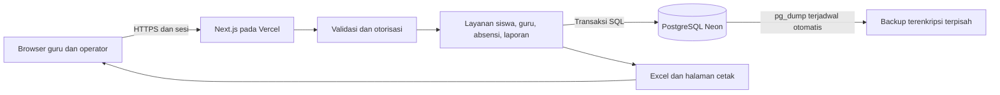

# Technical Reference Document

## Sistem Manajemen Siswa, Guru, dan Absensi SD

| Atribut | Nilai |
|---|---|
| Versi | 1.2 |
| Tanggal | 6 Oktober 2026 |
| Status | Disetujui Toku sebagai dasar implementasi; revisi 1.2 menyederhanakan protokol simpan, satu akun per orang, penanda ekspor, backup otomatis, dan branch Neon; aplikasi belum dibuat |
| Kebutuhan produk | [PRD](PRD.md) |
| Rencana eksekusi | [Implementation Plan](IMPLEMENTATION_PLAN.md) dan [Execution Log](IMPLEMENTATION_LOG.md) |
| Target awal | Satu sekolah, enam kelas, sekitar 60 siswa, dua guru |
| Infrastruktur pilihan Toku | Vercel Hobby dan Neon Free (project `rough-dawn-85427948`, branch `development` dan `production`); proyek sukarela non-komersial |

## 1. Apa yang dibangun?

Satu aplikasi web dengan UI dan API dalam deployment Next.js yang sama. PostgreSQL Neon menyimpan identitas, penempatan siswa, kalender, absensi, dan audit. Guru mengakses lewat browser, operator mengelola data dan menghasilkan Excel atau printout.



Diagram menunjukkan rancangan, bukan infrastruktur yang sudah tersedia. Integrasi SIKL belum dimasukkan karena kontrak atau format penerima belum diketahui.

### 1.1 Stack yang direkomendasikan

| Bagian | Pilihan | Alasan dan trade-off |
|---|---|---|
| Aplikasi | Next.js App Router, React, TypeScript | UI dan API satu deployment; memerlukan disiplin pemisahan kode server/client |
| Runtime | Node.js runtime untuk API dan ekspor | Mendukung driver transaksi dan workbook; pilih versi LTS yang didukung saat scaffold |
| Database | PostgreSQL pada Neon | Relasi kelas dan transaksi cocok dengan model sekolah |
| Query/migrasi | Drizzle ORM + Drizzle Kit | Skema dan SQL mudah diperiksa; constraints kompleks tetap melalui migrasi SQL |
| Driver | pg/node-postgres melalui pooled connection Neon | Transaksi interaktif untuk lock dan validasi; pool harus kecil dan sesuai serverless |
| Autentikasi | Better Auth, email/password, Drizzle adapter, admin plugin | Akun/session dikelola library; aturan guru/kelas tetap di aplikasi |
| Validasi | Zod pada batas API dan form | Satu kontrak input; server tetap menjadi otoritas |
| Styling | Tailwind CSS dengan komponen dasar sendiri | Cepat untuk layout responsif; identitas visual tidak ditetapkan, spesifikasi ini menetapkan perilaku saja |
| Excel | ExcelJS dalam Node.js | Menulis .xlsx, format tabel dan pengaturan cetak; ekspor dibuat saat diminta |
| Cetak | Halaman HTML dengan print CSS | Menghindari layanan PDF/headless browser untuk kebutuhan awal |
| Pengujian | Vitest, PostgreSQL uji, Playwright | Aturan murni, transaksi SQL nyata, lalu tugas guru di browser |

Versi patch dependency dipilih dari rilis stabil yang kompatibel saat implementasi lalu dipin dalam lockfile. Jangan mengambil beta/RC hanya karena muncul pada contoh dokumentasi. API internal memakai Route Handlers; halaman server boleh memanggil layanan baca yang sama tanpa HTTP internal tambahan. Dukungan Route Handlers dan rekomendasi otorisasi dekat data dijelaskan pada [Next.js Route Handlers](https://nextjs.org/docs/app/getting-started/route-handlers) dan [Next.js Authentication](https://nextjs.org/docs/app/guides/authentication).

Drizzle mendokumentasikan beberapa driver Neon; pilih driver dengan transaksi interaktif, bukan mengasumsikan transaksi callback bekerja pada HTTP driver. [Drizzle Neon](https://orm.drizzle.team/docs/connect-neon), [Drizzle Transactions](https://orm.drizzle.team/docs/transactions).

Pool pg dibuat di scope modul dengan ukuran awal kecil (usulan max=3), timeout koneksi dan query terukur, serta client dilepas pada finally. Integrasikan `attachDatabasePool` bila memakai Fluid Compute agar koneksi idle dikelola ketika fungsi ditangguhkan. Semua query satu transaksi harus memakai client yang sama; row lock (`SELECT ... FOR UPDATE/FOR SHARE`) berlaku per transaksi sehingga aman melalui pooled endpoint. Jangan memakai advisory lock tingkat session. [Vercel Connection Pooling](https://vercel.com/kb/guide/connection-pooling-with-functions).

### 1.2 Batas struktur

Satu deployable dan satu database cukup untuk kebutuhan ini. Pisahkan fungsi dengan lapisan tipis: handler menerima input, guard menentukan akses, service menjalankan aturan/transaksi, query menangani data, serializer menghasilkan respons. Jangan membuat service terpisah untuk setiap fitur atau abstraksi repository generik tanpa kebutuhan.

Struktur berikut adalah rencana, bukan daftar berkas yang sudah tersedia:

```text
src/
  app/                 pages, layouts, api route handlers
  components/          form, daftar siswa, tabel rekap
  server/
    auth/              konfigurasi auth dan guards
    services/          student, teacher, attendance, calendar
    queries/           pembacaan daftar dan agregat
    db/                schema, pool, migrasi
    reports/           proyeksi bersama, workbook, model cetak
  domain/              aturan tanggal, status, penempatan, totals
  contracts/           skema request dan response
tests/
  domain/
  integration/
  e2e/
docs/
```

Kode database/auth diberi batas server-only. Tidak ada connection string atau modul Excel dalam bundle browser.

## 2. Bagaimana identitas dan akses bekerja?

### 2.1 Identitas aplikasi

Better Auth mengelola user, account, session, dan verification sesuai schema library, berjalan di dalam aplikasi Next.js dan menyimpan tabelnya di database Neon yang sama. Password tidak disimpan pada tabel teacher. Satu orang memakai satu akun. Guru merupakan profil domain dengan tautan opsional satu-ke-satu ke user. Guru yang ditunjuk sebagai admin memakai akunnya sendiri dengan role `admin`, untuk tugas harian maupun administrasi; tidak ada akun admin kedua untuk orang yang sama. Akun admin tanpa profil teacher hanya dibuat bila ada operator yang bukan guru. Credential tidak dibagikan.

Neon Auth (`auth: true` pada `neon.ts`) tidak dipakai pada rilis ini. Dokumentasi Neon Auth saat perencanaan belum mencantumkan dukungan field user kustom, dan kustomisasi admin plugin masih ditandai segera hadir ([Neon Auth roadmap](https://neon.com/docs/auth/roadmap.md)), sedangkan rancangan ini membutuhkan `must_change_password`, sign-up tertutup, dan pembatasan endpoint admin.

Konfigurasi yang disetujui:

- Email/password aktif, public sign-up dimatikan pada server.
- Admin pertama dibootstrap melalui CLI terkontrol dengan rahasia dari input aman dan dapat langsung ditautkan ke profil guru yang ditunjuk; tidak menanam password pada seed/migrasi.
- Admin membuat akun guru menggunakan API library yang didukung, bukan menulis hash manual.
- Role domain efektif hanya `admin` atau `teacher`; default user library tidak memperoleh akses sekolah.
- Cookie sesi HttpOnly, Secure di produksi, SameSite, trusted origin ketat; POST/PATCH memeriksa Origin dan proteksi CSRF yang relevan.
- Setiap permintaan domain memeriksa sesi serta status dari database: user tidak banned, role `admin` atau `teacher`, `must_change_password` bersih, dan profil teacher aktif bila tertaut. Role `teacher` wajib tertaut ke profil teacher aktif; akun yang belum tertaut tidak memperoleh akses domain. Cache sesi client tidak menjadi otoritas status aktif.
- Penonaktifan akun mencabut seluruh sesi, dan pengecekan status tetap menolak sesi lama yang ter-cache. Arsip profil teacher menulis `teachers.active = false`, menandai user banned, dan menghapus baris session dalam satu transaksi domain; karena guard membaca status tersebut, akses tertutup secara atomik.
- Credential sementara memakai flag `must_change_password`; hanya logout/perubahan password tersedia sebelum flag dibersihkan server setelah sukses.
- Admin reset password melalui library, mencabut sesi, menandai wajib ganti. Penyampaian credential dilakukan oleh operator melalui kanal yang disepakati; tanpa layanan email otomatis pada MVP.
- Bootstrap/reset darurat didokumentasikan sebagai pekerjaan operator teknis; endpoint reset tanpa autentikasi tidak dibuat.
- Endpoint bawaan admin plugin dikonfigurasi dengan hak minimum. Impersonation, pengubahan role bebas, dan operasi library yang melewati aturan admin terakhir harus dinonaktifkan/ditolak server atau diakses hanya melalui wrapper aplikasi dengan guard yang sama.

Pilihan ini berdasarkan [Better Auth Email/Password](https://better-auth.com/docs/authentication/email-password), [Options](https://better-auth.com/docs/reference/options), [Drizzle Adapter](https://better-auth.com/docs/adapters/drizzle), dan [Admin Plugin](https://better-auth.com/docs/plugins/admin). Pembatasan perubahan password sementara dan hak domain merupakan kebutuhan aplikasi, bukan kemampuan yang diasumsikan otomatis dari library.

### 2.2 Matriks akses

| Operasi | Guru aktif | Admin aktif |
|---|---|---|
| Daftar siswa, kelas, penempatan | Baca seluruh sekolah | Baca dan kelola |
| Profil guru/kelas utama | Baca nama/status/kelas; tanpa rahasia akun | Kelola |
| Kalender/tahun ajaran | Baca | Kelola |
| Absensi tahun ajaran aktif | Baca, simpan, koreksi semua kelas | Sama |
| Absensi tahun ajaran lama | Baca | Koreksi dengan alasan |
| Void sesi | Tidak | Ya, dengan alasan |
| Rekap/Excel/cetak | Baca dan ekspor | Sama |
| User/reset/role/audit administratif | Tidak | Kelola |

Semua endpoint menjalankan guard, termasuk download/cetak dan panggilan server page. Kelas utama hanya preferensi kerja. Akses seluruh kelas bagi semua guru aktif sudah disetujui Toku pada Q-04. Scope rilis adalah satu sekolah; jangan menawarkan multi-tenant sebelum ada desain isolasi dan uji akses lintas sekolah.

## 3. Data apa yang disimpan?

### 3.1 Model relasional

Semua id domain UUID. Date memakai PostgreSQL `date`; waktu kejadian memakai `timestamptz` UTC. Enum status dipetakan ke label Indonesia di UI. Tabel berikut adalah schema usulan untuk diterjemahkan ke migrasi, bukan DDL siap dieksekusi.

| Tabel | Field penting | Relasi dan invariants |
|---|---|---|
| school_config | id singleton, name, location nullable, timezone, version, configured_at nullable, updated_at, updated_by nullable | Tabel konfigurasi bertipe; hanya satu baris; timezone awal Asia/Kuala_Lumpur, dapat diubah admin |
| academic_years | id, label, starts_on, ends_on_exclusive, is_current, archived_at, version | Rentang valid dan tidak tumpang tindih; partial unique untuk satu is_current=true; version naik untuk perubahan tahun, weekdays, dan overrides |
| school_weekdays | academic_year_id, weekday | PK gabungan; hari aktif wajib dipilih operator untuk setiap tahun |
| school_day_overrides | academic_year_id, date, is_school_day, reason | Unique(year,date); tanggal harus dalam rentang tahun |
| classes | id, academic_year_id, grade, name, archived_at, version | FK tahun; unique(year,name); grade 1..6; version untuk edit nama/arsip |
| students | id, student_code, full_name, nis nullable, nisn nullable, archived_at, version | Kode unik; nama bukan kunci; arsip tidak menghapus riwayat |
| enrollments | id, student_id, class_id, starts_on, ends_on_exclusive, exit_reason nullable | Kedua ujung interval wajib; tidak ada dua interval siswa yang overlap; rentang dalam tahun kelas |
| teachers | id, user_id nullable unique, full_name, active, version | FK auth user; profil boleh belum memiliki login |
| teacher_classes | teacher_id, class_id | PK gabungan; kelas utama bukan pembatas akses |
| attendance_sessions | id, class_id, date, state, version, submitted_by, submitted_at, void_reason nullable | Unique(class,date); state=submitted atau voided; version naik pada setiap perubahan isi dan void |
| attendance_records | id, session_id, enrollment_id, student_id, date, status | Unique(session,enrollment) dan unique(student,date); status H/S/I/A |
| report_exports | id, academic_year_id, month (tanggal 1), class_id nullable, format, session_versions, exported_by, exported_at | Append-only; class_id null berarti seluruh kelas; format xlsx atau print; session_versions berisi peta id sesi → version dari snapshot ekspor |
| audit_events | id, actor_id, action, entity_type, entity_id, occurred_at, request_id, reason nullable, changes_json | Append-only aplikasi; request_id adalah id korelasi server; tidak berisi credential atau payload login |

Schema auth dihasilkan/diadaptasi dari versi Better Auth terpilih. Role, status dan flag akses ditambahkan sesuai cara library; jangan menggandakan tabel session atau credential sendiri.

```mermaid
erDiagram
    ACADEMIC_YEAR ||--o{ CLASS : contains
    STUDENT ||--o{ ENROLLMENT : has
    CLASS ||--o{ ENROLLMENT : registers
    TEACHER ||--o{ TEACHER_CLASS : assigned
    CLASS ||--o{ TEACHER_CLASS : primary_for
    CLASS ||--o{ ATTENDANCE_SESSION : recorded_for
    ATTENDANCE_SESSION ||--o{ ATTENDANCE_RECORD : contains
    ENROLLMENT ||--o{ ATTENDANCE_RECORD : identifies
```

### 3.2 Integritas database dan riwayat

- Enrollment menggunakan interval setengah terbuka `[starts_on, ends_on_exclusive)`. Transfer efektif tanggal D berarti kelas lama berhenti sebelum D dan kelas baru mulai D.
- Exclusion constraint GiST atas student_id dan daterange mencegah enrollment overlap, termasuk antar tahun/kelas; extension `btree_gist` diperlukan dan diverifikasi pada database M0. Enrollment awal memakai ends_on_exclusive tahun ajaran sebagai nilai default wajib; siswa keluar/transfer memperpendek rentang. Tidak ada interval tanpa akhir yang memblokir enrollment tahun berikutnya. Pola exclusion constraint untuk range dan gabungan scalar dijelaskan pada [PostgreSQL Range Types](https://www.postgresql.org/docs/current/rangetypes.html).
- Constraint `CHECK` memastikan ends_on_exclusive > starts_on, nama/kode tidak kosong, dan status valid. Batas rentang terhadap tahun ajaran dan relasi lintas tabel divalidasi service dalam transaksi terkunci.
- Records merujuk session dan enrollment. Gunakan composite foreign keys atau trigger validasi agar student_id cocok dengan enrollment, date cocok dengan session, dan enrollment.class_id cocok dengan session.class_id. Pilihan migrasi harus menguji penolakan hubungan tidak sah di database.
- Relasi riwayat memakai `ON DELETE RESTRICT`. Admin mengarsipkan profil/kelas; credential boleh dinonaktifkan tanpa menghapus identitas pencatat.
- `archived_at` tidak mengubah status historis wajib hadir; rentang enrollment adalah sumber penentuan roster.
- Arsip student/class/year memerlukan penutupan seluruh penempatan yang masih efektif untuk masa selanjutnya, dengan validasi histori yang sama. Arsip sendiri tidak boleh meninggalkan siswa wajib hadir pada kelas yang tidak bisa dibuka. Jika tahun/class diarsipkan lebih awal, operator menutup penempatan melalui workflow admin sebelum arsip; arsip ditolak bila masih ada enrollment efektif setelah tanggal arsip. Arsip hanya menyaring daftar kerja default, bukan akses laporan historis.
- Kalender tahun lama tetap tersedia. Mengubah starts_on/ends_on tahun yang sudah dipakai absensi ditolak pada MVP.
- Audit menyimpan perubahan penempatan, kode/nama, akun aktif, kelas utama, kalender, config, dan simpan/koreksi/void sesi. Ekspor dicatat pada report_exports, bukan baris audit tambahan. Koreksi nama akan terlihat pada ekspor berikutnya sebagai nama terbaru; audit mencatat nama lama. Snapshot laporan yang pernah dikirim disimpan operator sebagai berkas terpisah; laporan berikutnya menandai data yang berubah sesudah ekspor terakhir (bagian 7.3).

Indeks minimal: enrollment(student_id, starts_on), enrollment(class_id, starts_on), sessions(class_id,date), records(student_id,date), audit(entity_type,entity_id,occurred_at), report_exports(academic_year_id, month, exported_at). Hindari membuat indeks untuk setiap field tanpa query nyata.

### 3.3 Status kosong dan sesi dibatalkan

Tidak ada row berarti Belum dicatat. Draft guru berada di state halaman browser. Session pertama dibuat saat submit berhasil, sehingga membuka halaman tidak menghidupkan compute untuk penulisan draft atau menghasilkan kehadiran palsu.

Saat admin void sesi, hapus current records pada transaksi yang sama, simpan isi sebelumnya lengkap dalam audit, dan ubah session ke voided dengan version+1. Ini memungkinkan unique(student,date) tetap berlaku pada current records. Session dan audit tetap ada; laporan memperlakukan sesi voided sebagai belum dicatat. Submit berikutnya dapat mengisi ulang sesi itu dengan expectedVersion terbaru; audit sebelum/sesudah tetap tersedia.

## 4. Bagaimana roster, tanggal dan kalender dihitung?

`schoolToday` dihitung di server berdasarkan school_config.timezone. Asia/Kuala_Lumpur adalah nilai awal configurable; waktu sekolah tidak mengikuti zona waktu laptop pengembang. Browser menerima schoolToday dan timezone dari server. Jangan mengubah date-only menjadi UTC midnight lalu menampilkan lewat timezone browser.

### 4.0 Konfigurasi sekolah

Admin mengatur nama sekolah, lokasi, dan zona waktu melalui `/settings`. Tabel `school_config` memakai kolom bertipe agar validasi/versi jelas; credential provider dan secret auth tetap berada di environment, bukan tabel config. Tahun ajaran, weekdays, dan tanggal pengecualian tetap pada tabel relasional tersendiri dengan form konfigurasi admin.

Validasi timezone sebagai identifier IANA yang didukung runtime. Setup menandai configured_at hanya setelah identitas dan kalender minimum valid. Data produksi tidak memakai nama sekolah atau kalender contoh. Perubahan config memakai expectedVersion form settings, exclusive row lock pada school_config, audit dan version+1. Perubahan timezone setelah ada absensi memerlukan reason serta preview waktu lokal sebelum/sesudah; tanggal records lama tetap date-only dan tidak direinterpretasi. Kalender weekday mengikuti date tersimpan, sementara batas hari ini memakai timezone terbaru.

Mutasi absensi tidak membawa versi config dan tidak mengunci school_config. Tanggal kerja selalu eksplisit di URL, dan pemeriksaan `date <= schoolToday` dilakukan server di dalam transaksi simpan memakai timezone yang berlaku saat itu. Perubahan timezone yang terjadi bersamaan setara dengan urutan serial: simpan dinilai memakai timezone sebelum atau sesudah perubahan, dan keduanya menghasilkan tanggal yang valid atau penolakan FUTURE_DATE. Label "hari ini" pada halaman yang sudah terbuka dapat usang sampai dimuat ulang, tetapi tidak dapat menghasilkan record yang salah. Laporan membaca config dalam snapshot yang sama dengan data laporan.

Roster kelas untuk tanggal D adalah enrollment yang class_id cocok dan `starts_on <= D < ends_on_exclusive`. Ujung interval tersimpan eksplisit pada semua enrollment. Tidak memakai daftar siswa aktif hari ini untuk laporan bulan lalu.

Hari belajar ditentukan oleh override tanggal bila ada, selain itu weekday yang dikonfigurasi tahun ajaran. Calendar dengan hari belajar kosong/tahun tidak siap memblokir submit dan menunjukkan kebutuhan konfigurasi. Tidak mengasumsikan hari sekolah Malaysia atau Indonesia sebelum operator mengisi.

Halaman Kalender Akademik menyajikan hasil resolusi hari per bulan: academic_years menentukan rentang, school_weekdays menentukan hari rutin, dan school_day_overrides mengganti keputusan tanggal tertentu. GET calendar mendukung filter bulan dan mengembalikan pola, overrides serta effective days untuk tampilan. Guru memiliki akses baca, admin dapat mengedit. Kalender visual, submit dan laporan memakai resolver hari belajar yang sama; judul/reason libur berasal dari overrides, bukan state UI terpisah.

### 4.1 Perubahan penempatan

Service penempatan mengunci row student dan semua class terdampak dengan urutan id yang stabil, lalu memeriksa rentang dan sessions. Semua penulisan absensi juga mengunci row class, sehingga perubahan roster dan submit tidak lolos bersamaan tanpa validasi.

Jika perubahan tanggal efektif mengubah roster pada sesi submitted, tolak `HISTORICAL_ROSTER_CHANGE` dan tampilkan tanggal efektif aman berikutnya. Untuk perubahan masa depan atau hari yang belum dicatat, tutup interval lama, buat interval baru, tulis audit, lalu commit. Perubahan satu siswa dalam batch naik kelas merupakan transaksi yang sama atau batch terkontrol yang melaporkan hasil per siswa; tidak ada promosi diam-diam sebagian.

Draft yang terbuka tidak membawa nomor revisi roster. Submit membandingkan himpunan enrollment yang dikirim dengan roster tanggal itu di bawah class lock (bagian 5.3). Perubahan penempatan yang memengaruhi tanggal draft otomatis menghasilkan ROSTER_CHANGED, sementara perubahan untuk tanggal lain tidak mengganggu draft. Koreksi penempatan lama yang sudah salah bukan fitur rutin MVP dan memerlukan runbook pemeliharaan dengan backup serta rekonsiliasi laporan.

Penempatan memakai expectedVersion siswa; setiap transfer, penutupan, pembatalan rencana, arsip atau penempatan baru menaikkan version siswa. Transfer di dalam tahun yang sama menutup sumber pada tanggal efektif dan menambahkan tujuan sampai akhir tahun. Penempatan tahun berikutnya memakai mode placement dan tidak memotong interval lama. Preview batch memvalidasi tiap siswa dalam snapshot read-only; apply mengunci seluruh tahun/siswa/kelas terurut, memvalidasi ulang semua pilihan, lalu menyimpan seluruh batch dalam satu transaksi atau menolak seluruhnya. Respons sukses memuat hasil setiap siswa.

Penempatan mendatang yang belum dimulai dapat dibatalkan melalui endpoint end dengan endsOnExclusive sama dengan startsOn. Layanan menolak bila rentang memiliki sesi submitted; rencana dihapus dari roster aktif dan snapshot lengkap tetap ada pada audit enrollment.cancel serta riwayat siswa bertanda dibatalkan. Arsip siswa ditolak selama masih ada enrollment berakhir setelah schoolToday. Lock siswa untuk lifecycle memakai FOR NO KEY UPDATE karena primary key tidak berubah; ini kompatibel dengan KEY SHARE dari foreign key attendance_records dan tetap menyerialkan perubahan version/interval.

### 4.2 Perubahan kalender

Submit, void, dan perubahan penempatan mengunci row academic_year dengan `FOR SHARE`, lalu class dengan `FOR UPDATE`, diikuti session. Perubahan kalender dan tahun ajaran mengunci academic_year dengan `FOR UPDATE`, sehingga tidak berlomba dengan submit tetapi submit kelas berbeda tidak saling menunggu. Jika sebuah tanggal hendak diubah ke libur tetapi memiliki sessions submitted, server menolak dan menampilkan sesi yang harus di-void admin terlebih dahulu. Setelah void selesai, operator dapat mengubah kalender dengan alasan. Tidak otomatis mengganti absensi menjadi libur.

Aturan lock global: academic_year → students bila operasi menyentuh siswa → classes terurut → session. school_config hanya dikunci (exclusive) oleh update settings; mutasi lain membacanya tanpa lock. Transaksi transfer dan kalender mengikuti urutan yang sama. Penulisan multi-tahun mengunci year terurut terlebih dahulu. Batasi scope transaksi dan jangan menjalankan network call di dalamnya. Deadlock yang tetap terjadi diretry secara terbatas di server.

## 5. Bagaimana absensi disimpan dengan aman?

### 5.1 Kontrak baca

`GET /api/classes/{classId}/attendance?date=YYYY-MM-DD` mengembalikan:

```json
{
  "classId": "uuid",
  "date": "2026-10-06",
  "schoolToday": "2026-10-06",
  "timezone": "Asia/Kuala_Lumpur",
  "isSchoolDay": true,
  "sessionState": "not_recorded",
  "sessionVersion": null,
  "submittedBy": null,
  "submittedAt": null,
  "students": [
    {
      "enrollmentId": "uuid",
      "studentId": "uuid",
      "studentCode": "S-0001",
      "fullName": "Contoh siswa",
      "status": null
    }
  ]
}
```

Data di atas adalah contoh kontrak, bukan data siswa nyata. State hasil baca adalah not_recorded/submitted/voided. UI menampilkan status null sebagai Belum dicatat. Untuk sesi submitted, submittedBy berisi id dan nama akun pencatat terakhir.

### 5.2 Kontrak submit

`PUT /api/classes/{classId}/attendance/{date}` menerima semua status eksplisit dari roster yang baru dibaca. UI boleh mengisi H untuk siswa yang belum dipilih hanya sesudah konfirmasi guru; server tidak mengisi H dari daftar request yang tidak lengkap.

```json
{
  "expectedVersion": null,
  "entries": [
    { "enrollmentId": "uuid", "status": "H" }
  ],
  "reason": null
}
```

Untuk koreksi, expectedVersion berupa integer dan reason wajib. Submit ulang sesi voided juga memerlukan reason. Penulisan pada tahun ajaran yang bukan current hanya untuk admin dan selalu memerlukan reason. Body tidak membawa requestId; server membuat id korelasi untuk log dan audit, lalu mengembalikannya pada header respons.

### 5.3 Protokol transaksi

1. Validasi struktur, batas ukuran request, format tanggal, semua status, dan enrollmentId ganda (400 INVALID_INPUT). Autentikasi actor dan hak role melalui guard yang membaca status database. Actor berasal dari sesi, bukan body.
2. Mulai transaksi. Baca school_config tanpa lock. Kunci academic_year `FOR SHARE`, class `FOR UPDATE`, dan existing session `FOR UPDATE`.
3. Validasi tahun ajaran dan hak periode (tahun bukan current hanya admin dengan reason), kesiapan setup, hari belajar, dan `date <= schoolToday` memakai timezone yang dibaca pada transaksi ini.
4. Hitung roster dari enrollment bertanggal dalam transaksi. Roster kosong menghasilkan 422 EMPTY_ROSTER. Himpunan enrollmentId pada entries yang tidak persis sama dengan roster menghasilkan 409 ROSTER_CHANGED.
5. Jika session submitted sudah ada dan seluruh status sama persis dengan entries, kembalikan 200 dengan metadata sesi saat ini dan `changed: false`, tanpa menaikkan versi, menulis records, atau audit. Langkah ini membuat kirim ulang dan klik ganda aman tanpa tabel receipt.
6. Bandingkan expectedVersion. Session baru hanya boleh expectedVersion=null; existing submitted/voided harus cocok version. Ketidakcocokan menghasilkan 409 VERSION_CONFLICT. Reason wajib untuk koreksi dan isi ulang sesi voided.
7. Buat session versi 1 atau tingkatkan versi existing dengan state submitted. Tulis seluruh records (replace current set secara transaksional), identitas pencatat terakhir, dan waktu.
8. Tulis audit status sebelumnya/baru, alasan, dan id korelasi.
9. Commit, lalu kirim respons berisi sessionVersion, submittedAt, submittedBy, totals, dan `changed: true`. UI baru menampilkan Tersimpan setelah menerima sukses.

Jika dua guru membaca version=2 dan menyimpan isi berbeda, simpan pertama menghasilkan version=3; simpan kedua menerima 409 tanpa menulis record atau audit. Jika isi keduanya sama, simpan kedua menjadi no-op sukses yang menampilkan pencatat sebenarnya. Jika dua guru mencoba sesi baru sekaligus, class lock serta unique(class,date) memastikan hanya satu initial submit yang menulis.

Jika koneksi putus setelah commit, retry dengan isi yang sama menjadi no-op sukses pada langkah 5, sehingga guru melihat Tersimpan tanpa duplikasi. Klien tidak mengirim ulang otomatis dengan expectedVersion baru tanpa menampilkan data terbaru kepada pengguna. Tabel receipt (`mutation_receipts`) ditunda ke backlog dan hanya ditambahkan bila pilot membuktikan kebutuhan pada mutasi admin.

### 5.4 Void sesi dan koreksi

`POST /api/classes/{classId}/attendance/{date}/void` admin-only, dengan expectedVersion dan reason. Gunakan urutan lock dan validasi periode yang sama. Audit menyimpan isi sebelumnya sebelum current records dihapus; session berubah menjadi voided dengan version+1. Pengulangan request setelah void berhasil menerima 409 karena versi sudah berubah, lalu UI memuat ulang dan menampilkan sesi yang sudah dibatalkan.

Koreksi individual di UI dikirim sebagai submit penuh dari versi terbaru, bukan API patch yang dapat melewati validasi roster. Jika tidak ada perubahan status, langkah no-op pada bagian 5.3 berlaku.

## 6. Apa kontrak operasi aplikasi?

### 6.1 API domain

Prefix semua endpoint domain `/api`. Auth library dipasang pada namespace terpisah sesuai integrasi Next.js. Pagination berbasis limit/cursor dengan limit maksimum 100 untuk daftar; semua query memiliki scope tahun/kelas/tanggal yang jelas.

| Metode dan endpoint | Fungsi | Peran |
|---|---|---|
| GET /settings | Identitas sekolah, lokasi, zona waktu, versi config, kesiapan setup | Guru/admin |
| PATCH /settings | Konfigurasi sekolah; preview/alasan untuk perubahan timezone sesudah ada absensi | Admin |
| GET, POST /academic-years | Daftar/buat periode | Baca semua; tulis admin |
| PATCH /academic-years/{id} | Label, periode current, arsip | Admin |
| GET, PUT /academic-years/{id}/calendar | Weekdays dan overrides | Baca semua; tulis admin |
| GET, POST /classes | Daftar/buat kelas | Baca semua; tulis admin |
| PATCH /classes/{id} | Nama/arsip; grade/year tidak diubah setelah enrollment | Admin |
| GET, POST /students | Filter/list/buat siswa dengan enrollment awal | Baca semua; tulis admin |
| GET, PATCH /students/{id} | Detail dan ubah nama/kode/arsip | Baca semua; tulis admin |
| POST /students/{id}/enrollments | Daftar baru/transfer/naik kelas bertanggal | Admin |
| PATCH /enrollments/{id}/end | Menutup penempatan siswa keluar | Admin |
| POST /enrollments/promote/preview | Preview hasil validasi per siswa tanpa menulis | Admin |
| POST /enrollments/promote | Batch penempatan atomik dengan hasil per siswa | Admin |
| GET, POST /teachers | Daftar/buat profil | Baca semua; tulis admin |
| PATCH /teachers/{id} | Nama/status | Admin |
| PUT /teachers/{id}/classes | Kelas utama | Admin |
| POST /teachers/{id}/account | Buat/tautkan akun melalui auth service | Admin |
| PATCH /users/{id}/access | Aktif/nonaktif/role melalui wrapper guarded | Admin |
| POST /users/{id}/reset-password | Reset administratif, revoke sesi, wajib ganti | Admin |
| POST /account/change-password | Ganti credential sementara/normal | Pengguna bersesi |
| GET /dashboard?date=... | Status kelas pada tanggal | Guru/admin |
| GET /classes/{id}/attendance?date=... | Roster/status/version | Guru/admin |
| PUT /classes/{id}/attendance/{date} | Submit awal/koreksi penuh | Sesuai periode |
| POST /classes/{id}/attendance/{date}/void | Pembatalan tercatat | Admin |
| GET /classes/{id}/attendance/{date}/history | Audit absensi | Guru/admin |
| GET /reports/attendance?yearId=...&month=YYYY-MM&classId=... | Proyeksi rekap | Guru/admin |
| GET /reports/attendance.xlsx dengan filter yang sama | Download workbook; mencatat report_exports format xlsx | Guru/admin |
| POST /reports/exports | Mencatat cetak (format print) saat tombol Cetak ditekan | Guru/admin |
| GET /audit dengan filter bounded | Audit administratif | Admin |
| GET /health | Liveness tanpa data pribadi atau query DB | Publik, isi minimal |

Form edit master memakai optimistic version (kolom version pada school_config, academic_years, classes, students, teachers) agar perubahan tidak menimpa edit operator lain. Mutasi compound penempatan, akses, kalender dan void memakai transaksi, urutan lock bagian 4.2, dan expectedVersion; tabel receipt ditunda (bagian 12). Wrapper akun memanggil API server Better Auth dengan adapter Drizzle yang terikat PoolClient transaksi domain yang sama, tanpa transaksi internal adapter atau panggilan HTTP. Pembuatan akun, credential, dan tautan profil commit bersama; kegagalan penautan membatalkan semuanya. Reset password juga memakai client transaksi tersebut. Akun role teacher tanpa profil aktif tetap ditolak guard domain. Integrasi S2-C1 memverifikasi rollback melalui trigger PostgreSQL yang menggagalkan penautan.

### 6.2 Respons kesalahan

Format: `{ "error": { "code": "...", "message": "...", "fieldErrors": {} }, "requestId": "..." }`. RequestId korelasi log tidak memasukkan token/credential.

| HTTP | Code contoh | Tindakan pengguna |
|---|---|---|
| 400 | INVALID_INPUT | Perbaiki field yang ditandai |
| 401 | SESSION_EXPIRED | Login lalu buka ulang catatan; draft belum tersimpan diberi peringatan |
| 403 | ACCESS_DENIED / PASSWORD_CHANGE_REQUIRED | Hak tidak sesuai atau wajib ganti password |
| 404 | RESOURCE_NOT_FOUND | Kelas/siswa tidak ditemukan |
| 409 | VERSION_CONFLICT / ROSTER_CHANGED | Muat data baru; jangan otomatis menimpa |
| 409 | HISTORICAL_ROSTER_CHANGE / CALENDAR_HAS_ATTENDANCE | Pilih tanggal aman atau gunakan tindakan admin yang dijelaskan |
| 422 | HOLIDAY / FUTURE_DATE / OUTSIDE_ACADEMIC_YEAR / EMPTY_ROSTER / SETUP_INCOMPLETE | Periksa tanggal, daftar siswa, atau lengkapi setup |
| 429 | RATE_LIMITED | Tunggu; tidak mengubah status menjadi tersimpan |
| 503 | SERVICE_UNAVAILABLE | Pertahankan draft selama halaman terbuka dan coba ulang |

Tidak ada response SQL mentah, stack trace, hash password, atau session token kepada browser. Terapkan pembatasan auth memakai penyimpanan bersama database/library yang sesuai serverless; in-memory rate limit saja tidak cukup antar invocation. Parameter batas ditetapkan pada implementasi dan diuji untuk menghindari mengunci kedua guru secara berlebihan di Wi-Fi yang sama.

## 7. Bagaimana rekap dibuat?

### 7.1 Satu proyeksi untuk semua keluaran

`buildMonthlyAttendanceReport(yearId, month, classId?)` membentuk objek laporan dengan metadata, kalender, roster historis, sel per tanggal, totals, completeness, dan penanda perubahan setelah ekspor (bagian 7.3). JSON UI, workbook Excel, dan halaman cetak memakai objek yang sama. Tidak menyimpan tabel totals yang dapat tertinggal setelah koreksi.

Algoritma setiap sel:

1. Jika tanggal di luar tahun/interval enrollment siswa pada kelas itu, hasil `-`.
2. Jika bukan hari belajar, hasil `L`.
3. Jika tanggal > schoolToday, hasil `.`.
4. Jika ada record dari session submitted, hasil H/S/I/A.
5. Selain itu, hasil `?`.

`expectedDaysToDate = H + S + I + A + missingDays`. `recordedDays = H + S + I + A`. `complete = missingDays == 0` untuk semua siswa yang diwajibkan pada tanggal yang telah tiba. Jika persentase ditampilkan, label **Hadir dari hari tercatat** menggunakan H/recordedDays, tampilkan kelengkapan terpisah; denominator nol menghasilkan null, bukan 0% atau 100%. MVP cukup menampilkan totals tanpa persentase agar laporan tidak menyesatkan.

Siswa transfer pada tanggal D: kelas lama memakai `-` mulai D; kelas baru memakai `-` sebelum D. Kalender sama untuk seluruh sekolah pada MVP. Tidak ada absensi ngaji/per pelajaran kedua pada tanggal yang sama.

### 7.2 Konsistensi pembacaan dan ekspor

- Ambil data laporan dalam satu transaksi REPEATABLE READ dengan snapshot konsisten; tampilan memakai mode read-only, sedangkan ekspor xlsx menambahkan satu insert report_exports pada transaksi yang sama. Jangan membaca totals dan sel dalam snapshot berbeda.
- Snapshot REPEATABLE READ membuat seluruh pembacaan laporan melihat kondisi yang sama meski ada koreksi bersamaan; lihat [PostgreSQL Transaction Isolation](https://www.postgresql.org/docs/current/transaction-iso.html).
- Query roster, kalender, dan records secara batch untuk bulan terpilih. Tidak menjalankan query per siswa per tanggal.
- Unduhan dibatasi satu bulan dan satu tahun ajaran; classId opsional untuk seluruh kelas. Query di luar rentang tahun menghasilkan validation error.
- Simpan metadata pengekspor dan waktu pembuatan dalam workbook; report_exports merekam ekspor/cetak beserta filter dan peta versi sesi, tanpa menyalin workbook ke log.
- Buat workbook dalam memory, lalu respons attachment dengan content type .xlsx. Nama sheet dinormalisasi, karakter terlarang diganti, panjang <=31, collision diberi suffix.
- Nilai nama/kode ditulis sebagai cell string, bukan formula; total berupa angka hasil proyeksi server. Jangan membuat formula dari input pengguna. Tidak menyediakan CSV pada MVP.
- Halaman cetak terautentikasi memakai print CSS A4 landscape, page break antar kelas, legenda, label Belum lengkap, dan judul tabel berulang. Hasil fisik diuji pada printer sekolah; kemampuan cetak HP belum diasumsikan.
- Header data dan ekspor `Cache-Control: private, no-store`; data pribadi tidak dicache CDN atau service worker.

ExcelJS menyediakan workbook dan pengaturan page setup yang diperlukan, lihat [repository ExcelJS](https://github.com/exceljs/exceljs). SIKL belum memiliki adapter; file tidak diberi label sebagai format resmi SIKL.

### 7.3 Penanda perubahan setelah ekspor

Tidak ada kunci bulan. Koreksi tetap dapat dilakukan setelah laporan diserahkan, dan laporan berikutnya memberi tahu apa yang berubah.

- Ekspor xlsx dicatat saat unduhan dibuat; cetak dicatat saat tombol Cetak ditekan. Membuka halaman rekap atau halaman cetak saja tidak dicatat.
- Setiap catatan report_exports menyimpan `session_versions`: peta id sesi → version untuk semua sesi pada kelas/bulan dalam scope, diambil dari snapshot yang sama dengan isi berkas. Untuk xlsx, proyeksi dan catatan ekspor dibuat dalam satu transaksi REPEATABLE READ; untuk cetak, POST mengirim peta versi yang tercantum pada halaman yang sedang dicetak, dan server memvalidasi bahwa setiap id sesi berada dalam scope filter.
- Untuk setiap kelas, ekspor acuan adalah catatan terbaru dengan tahun ajaran dan bulan yang sama serta class_id sama atau null (seluruh kelas).
- Tanggal berubah adalah tanggal sesi kelas itu pada bulan tersebut yang tidak ada di peta acuan atau version-nya berbeda. Ini mencakup koreksi, void, isi ulang, dan pengisian hari yang sebelumnya `?`.
- Bila ada tanggal berubah, UI, Excel, dan cetak menampilkan **Berubah setelah ekspor terakhir** beserta waktu dan nama pengekspor acuan serta daftar tanggalnya. Ekspor yang sedang dibuat memakai acuan sebelum dirinya, lalu menjadi acuan berikutnya.
- Perbandingan memakai versi, bukan timestamp, sehingga koreksi yang commit bersamaan dengan ekspor tetap terdeteksi bila tidak termasuk dalam berkas.

## 8. Bagaimana aplikasi dijalankan dan dipublikasikan?

### 8.1 Lingkungan dan konfigurasi

| Lingkungan | Database | Data |
|---|---|---|
| Lokal/test | PostgreSQL lokal (Docker atau instalasi lokal), satu database per worker uji | Data sintetis |
| Development/preview | Neon project `rough-dawn-85427948`, branch `development` | Data sintetis, tanpa salinan siswa produksi |
| Produksi | Neon project `rough-dawn-85427948`, branch `production` | Data nyata setelah gerbang M2 |

Integration test tetap memakai PostgreSQL lokal agar worker paralel memiliki database sendiri dan tidak menghabiskan CU-hours project. Kuota Neon Free berlaku per project, sehingga pemakaian branch development ikut mengurangi kuota yang sama dengan production. Branch development tidak boleh di-reset atau dibuat ulang dari production setelah data nyata masuk, karena branch Neon menyalin data induknya.

Penyiapan Neon CLI (dijalankan Toku, H-02): `npm i -g neon@latest && neon login`, `neon skills -y`, `neon mcp -y`. Agent kemudian menautkan direktori kerja ke branch development dengan `neon link --project-id rough-dawn-85427948 --branch development -y`, menjalankan `neon config init`, dan memakai `neon.ts` minimal tanpa layanan tambahan:

```ts
import { defineConfig } from "@neon/config/v1";

export default defineConfig({});
```

`neon deploy` menerapkan `neon.ts` ke branch yang ditautkan dan menarik variabel branch ke `.env` lokal ([neon.ts](https://neon.com/docs/reference/neon-ts.md)); `.env` wajib di-ignore git. Neon Auth, bucket storage, dan Neon Functions tidak diaktifkan: auth tetap Better Auth di aplikasi (bagian 2.1), compute tetap Vercel, dan rilis ini tidak menyimpan berkas. Bucket `public_read` dapat dibaca tanpa credential sehingga tidak dipakai untuk data sekolah. Agent, CLI, dan MCP Neon hanya dipakai pada branch development; penautan atau migrasi branch production dilakukan Toku melalui runbook rilis. Bila format `neon.ts` pada CLI terbaru berbeda, ikuti dokumentasi saat itu dengan prinsip yang sama: tanpa layanan tambahan.

Environment server-only: DATABASE_URL (pooled runtime), DATABASE_MIGRATION_URL (credential migrasi terpisah pada proses migrasi), BETTER_AUTH_SECRET, BETTER_AUTH_URL, TRUSTED_ORIGINS. Jangan memasang credential owner/migrasi di runtime bila role aplikasi dengan privilege minimum sudah dibuat. Tidak ada secret pada NEXT_PUBLIC_* atau Git.

Pilih region aplikasi dan database yang berdekatan di Asia berdasarkan ketersediaan plan dan hasil uji. Lokasi deployment tidak dianggap otomatis memenuhi kebijakan data sekolah; operator mengonfirmasi lokasi penyimpanan sebelum data nyata dimasukkan.

Commands berikut adalah kontrak script yang perlu dibuat pada scaffold, belum dapat dijalankan pada proyek dokumen ini:

| Script | Tujuan |
|---|---|
| dev / build / start | Pengembangan dan build aplikasi |
| lint / typecheck | Analisis kode dan kontrak |
| test:domain / test:integration / test:e2e | Pemeriksaan aturan, SQL, dan tugas browser |
| db:generate / db:migrate | Generate dan apply migrasi yang telah ditinjau |
| db:seed:test | Data contoh, hanya test/preview |
| auth:bootstrap-admin | Membuat admin awal secara aman |

Migrasi dijalankan sebagai pekerjaan terpisah sebelum deploy yang membutuhkannya, dengan backup dan review SQL. Jangan menjalankan db push/drop/seed produksi saat build, saat halaman dibuka, atau saat test. Preview tidak memakai DATABASE_URL produksi.

### 8.2 Anggaran free tier

Temuan provider diperiksa 6 Oktober 2026. Angka bukan jaminan penggunaan gratis selamanya; cek dashboard aktual saat provisioning. Ringkasan ini hanya mencakup batas yang memengaruhi rancangan.

| Provider | Batas yang ditemukan | Implikasi desain |
|---|---|---|
| Vercel Hobby | Non-commercial/personal use; 4 active CPU-hours, 360 GB-hours provisioned memory, 1 juta function invocations; dapat berhenti saat kuota habis | Validasi pola penggunaan aktual; satu deployment, tanpa background worker atau polling rutin |
| Neon Free | Pengumuman 2 Oktober 2026: 1 GB database/project, 100 CU-hours/project/bulan, 10 branches/project, instant restore 6 jam | Scale-to-zero, query on demand, kontrol branch; backup tambahan diperlukan |

Sumber: [Vercel Hobby](https://vercel.com/docs/plans/hobby), [Neon pembaruan Free 2 Oktober 2026](https://neon.com/blog/neon-free-plan-1-gb-per-project). Beberapa artikel Neon lama masih menyebut 0.5 GB; gunakan pengumuman terbaru dan verifikasi dashboard. Toku memutuskan proyek ini sukarela tanpa pembayaran (membantu teman KKN di sekolah sasaran), sehingga dipakai sebagai pemakaian non-komersial. Bila nanti ada pembayaran atau komersialisasi, plan hosting dievaluasi ulang. Dokumen ini tidak menyatakan otomatis memenuhi syarat berdasarkan label pendidikan; kesesuaian tetap mengikuti ketentuan Vercel yang berlaku.

Perkiraan beban, bukan benchmark: 60 siswa × 22 hari belajar contoh = 1.320 records/bulan; enam kelas × 22 = 132 initial submit/bulan. Koreksi, login, baca halaman dan ekspor menambah request. Pada 220 hari belajar contoh, records sekitar 13.200/tahun. Ukuran row/index/audit dan waktu compute tetap harus diukur setelah schema ada; jumlah records saja tidak membuktikan kecukupan kuota.

Hindari health check yang menjalankan SQL berkala karena dapat mempertahankan compute tetap aktif. Refresh data setelah mutation/navigasi atau permintaan pengguna. Jangan menghapus audit atau absensi untuk menghemat kuota tanpa kebijakan retensi sekolah.

Guru membuka aplikasi sekitar sekali sehari, sehingga pembukaan pertama hampir selalu terjadi saat compute Neon dan fungsi Vercel dalam kondisi dingin. Waktu buka pertama kondisi dingin diukur sejak M1 sebagai metrik yang dirasakan guru, terpisah dari latensi simpan kondisi hangat.

### 8.3 Deploy, monitoring, dan rollback

1. Jalankan lint, typecheck, uji aturan dan integrasi SQL pada DB uji; build; uji browser kritis.
2. Deploy preview dengan data sintetis pada branch Neon development sejak M1, periksa alur dua guru dan, setelah tersedia, ekspor/cetak.
3. Sebelum produksi, isi konfigurasi, identitas akun, perangkat dan tujuan backup sesuai keputusan Q-01 sampai Q-11 yang sudah disetujui; verifikasi kuota plan aktual, tinjau migrasi dan ambil backup branch production.
4. Terapkan migrasi additive/backward-compatible, deploy aplikasi, lakukan smoke test aman menggunakan data uji yang jelas terpisah.
5. Pantau error, request latency hangat/dingin, konflik, dan failed submit. Logs teknis cukup requestId, actorId, action, duration, errorCode; tanpa daftar nama siswa atau credentials.
6. Operator teknis memeriksa dashboard usage mingguan selama pilot dan setelah perubahan beban. Batas internal usulan: review saat penggunaan mencapai 70% kuota; ini pemicu operasional, bukan batas provider.
7. Jika deploy regresi, rollback aplikasi ke deployment sebelumnya yang kompatibel dengan schema. Jangan menghapus migrasi/data untuk rollback kode. Jika data rusak, gunakan prosedur pemulihan berikut.

URL produksi dan pemilik akun provider belum ada. Catat dashboard, pemilik dan akses pemulihan pada runbook saat provisioning; jangan menuliskan URL fiktif sebagai layanan aktif.

## 9. Bagaimana data dipulihkan?

RPO usulan paling lama satu hari belajar, RTO usulan satu hari kerja dengan operator teknis tersedia. Ini target operasional yang harus diuji, bukan SLA provider.

- Backup berjalan otomatis melalui runner terjadwal harian (GitHub Actions atau runner setara), sehingga mencakup setiap hari belajar tanpa bergantung pada ingatan operator. Job mengambil `pg_dump` format custom dari branch production memakai credential backup dan client dengan major version sama atau lebih baru dari server, mengenkripsi dengan `age` ke public key penerima, lalu mengunggah ke lokasi terpisah yang aksesnya terbatas. Private key disimpan offline oleh pemilik backup dan tidak pernah dibutuhkan oleh job.
- Menyimpan 30 backup terakhir; sekolah menentukan retensi data dan pemilik lokasi penyimpanan sebelum pilot nyata. Password, kunci enkripsi dan backup tidak masuk repo; credential job berada pada secret runner.
- Job gagal mengirim notifikasi ke pemilik runner. Operator teknis memeriksa mingguan bahwa backup terbaru ada dan dapat didekripsi.
- Backup mencakup schema, data domain, auth dan audit sesuai kebutuhan restore. Perlakukan backup auth sebagai data sensitif; setelah pemulihan ke produksi cabut semua sesi dan rotasi secret yang perlu.
- Sebelum pilot, restore dump di DB uji terpisah, bandingkan jumlah siswa/penempatan/sesi, validasi sample reports dan audit, lalu uji login setelah reset sesi.
- Saat insiden, hentikan writes, ambil snapshot kondisi rusak untuk investigasi, restore ke database baru, periksa laporan, lalu ubah koneksi dan buka kembali writes. Pertahankan database lama sampai operator menyetujui hasil restore.
- Kumpulkan catatan sementara guru sejak backup terakhir, masukkan ulang dengan alasan pemulihan. Jangan menyatakan RPO nol.

Instant restore provider membantu kejadian baru dalam jendela tersedia, tetapi tidak menggantikan backup terpisah. Excel menyimpan hasil laporan, tidak menyimpan penempatan, akun, semua audit dan hubungan database.

## 10. Bagaimana rancangan ini diverifikasi?

Pengujian dilakukan saat implementasi. Dokumen ini belum mempunyai hasil build atau uji aplikasi.

| Lapisan | Kasus wajib | Bukti penerimaan |
|---|---|---|
| Aturan tanggal/rekap | Libur, masa depan, `?`, enrollment mulai/akhir, transfer, Februari leap year, akhir bulan, batas tengah malam sekolah | Expected cells dan totals sesuai fixture |
| Integritas SQL | Enrollment overlap, unique student/date, FK session/enrollment tidak cocok | Constraint menolak state tidak sah |
| Transaksi absensi | Simpan penuh, kegagalan di tengah, double click, retry setelah commit | Semua-atau-tidak-sama-sekali; kirim ulang isi sama menjadi no-op sukses tanpa versi/audit baru |
| Konflik | Dua initial submit berbeda; dua koreksi berbeda dengan versi sama; roster tanggal itu berubah saat halaman terbuka | Satu menang, lainnya 409; tidak ada lost update; perubahan roster tanggal lain tidak mengganggu |
| Race master data | Transfer/calendar update bersamaan dengan submit | Hasil mengikuti lock dan aturan tanggal; deadlock diretry secara bounded pada server |
| Otorisasi | Guru mencoba seluruh endpoint admin dan auth-plugin admin; akun nonaktif memakai sesi lama; admin terakhir | Ditolak di server, bukan hanya menu tersembunyi |
| Rekap | Siswa keluar/naik kelas, void lalu isi ulang, koreksi setelah export | Laporan baru benar, audit lama terjaga, Excel/cetak sejalan |
| Penanda ekspor | Ekspor lalu koreksi/void/isi hari kosong; ekspor seluruh kelas vs per kelas; koreksi commit bersamaan dengan ekspor | Tanggal berubah tepat; ekspor baru menjadi acuan; perubahan yang tidak masuk berkas tetap ditandai |
| Browser | Guru memilih kelas, pengecualian, konfirmasi, koreksi, session expiry, jaringan gagal | Pesan/status sesuai data server; draft tidak disebut tersimpan |
| Config | Timezone berubah saat draft/simpan, kalender custom, config belum lengkap | Simpan divalidasi terhadap timezone yang berlaku; tanggal historis tetap; setup belum siap memblokir submit |
| HP/tablet | Viewport 360/768/1024, portrait/landscape, keyboard virtual, target sentuh 44px | Seluruh alur PRD 7.1 berjalan; pilihan absensi tetap saat rotasi; scroll horizontal hanya pada rekap |
| Print/XLSX | Enam lembar kelas, nama panjang, nama sheet collision, string mirip formula, A4 | Berkas terbuka di Excel/LibreOffice dan terbaca pada cetak nyata |
| Operasional | Backup otomatis, restore ke DB baru, koneksi DB salah, cold start | Pemulihan terukur; error aman; latency dingin dan hangat dicatat terpisah |

Data pengujian seluruhnya sintetis. Integration tests memakai PostgreSQL sesungguhnya dan role/schema yang menyerupai produksi; SQLite/mock tidak membuktikan transaksi, exclusion constraint, dan locks PostgreSQL.

## 11. Urutan implementasi dan keterlacakan

| Slice | Isi | PRD | Milestone | Hasil yang diverifikasi |
|---|---|---|---|---|
| Slice 1 | Scaffold, schema inti, auth dan guards, shell mobile, API dan UI absensi satu kelas, ringkasan hari ini, preview development | F-01/F-05/F-08/7.1 | M1 | Guru dapat mencoba alur nyata di HP dengan data contoh; transaksi dan konflik terbukti |
| Slice 2 (paralel) | Rekap/Excel/cetak dengan penanda ekspor; settings, tahun, kelas, kalender, siswa; guru dan akun; koreksi/riwayat/void; backup otomatis | F-02/F-03/F-04/F-06/F-07 | M2 | Totals cocok, setup lengkap lewat UI, rolling tanpa berbagi akun, restore drill lulus |
| Slice 3 | Lifecycle siswa, operasi tahun ajaran, audit admin, hardening, kesiapan rilis, panduan | Semua/Kualitas | M2/M4 | Riwayat tidak berubah, akses teruji, runbook siap |
| Pilot dan evaluasi | Checkpoint manusia H-01 sampai H-09 | Metrik | M3/M4 | Waktu/akurasi sesuai target atau revisi tercatat |

Task dan dependensinya dijabarkan dalam [Implementation Plan](IMPLEMENTATION_PLAN.md). Gunakan [Execution Log](IMPLEMENTATION_LOG.md) untuk mencatat perubahan, uji, hasil penerimaan, serta pekerjaan tersisa. Status rancangan bukan status implementasi.

## 12. Keputusan teknis dan batas yang diterima

| Keputusan | Alternatif | Alasan | Batas yang diterima |
|---|---|---|---|
| Next.js satu deployable | SPA dengan backend terpisah | Dua guru dan satu sekolah belum membutuhkan dua runtime/deploy | API tetap dibuat terpisah dari UI dalam kode agar dapat diekstrak bila perlu |
| PostgreSQL + riwayat enrollment | student.class_id tunggal | Transfer/naik kelas tidak boleh menulis ulang masa lalu | Lebih banyak relasi dan validasi tanggal |
| Satu transaksi per kelas | Autosave setiap tap | Konfirmasi guru jelas dan audit konsisten | Draft belum bertahan setelah halaman ditutup/reload |
| Semua guru akses seluruh kelas | Assignment sebagai ACL | Mendukung rolling; disetujui Toku | Pembatasan per kelas belum diperlukan |
| Satu akun per orang; admin sebagai role | Akun admin terpisah untuk guru yang ditunjuk | Lebih sedikit login; nama pencatat tidak terpecah; disetujui Toku | Akun guru admin memerlukan password kuat dan logout di perangkat bersama |
| No-op berbasis state + expectedVersion + unique(class,date) | Tabel mutation_receipts dengan advisory lock dan hash payload | Skala sekitar enam simpan per hari; kirim ulang isi sama sudah aman | Pengulangan mutasi admin non-absensi berakhir 409 lalu muat ulang; receipt ditambahkan bila pilot membuktikan perlu |
| Validasi himpunan roster di bawah class lock | rosterRevision per kelas | Presisi per tanggal, tanpa 409 palsu dari perubahan tanggal lain | Tidak ada |
| Tanggal eksplisit + validasi server saat commit | configVersion dan shared lock config pada setiap mutasi | Perubahan timezone tidak membuat tanggal draft salah | Label "hari ini" pada halaman lama dapat usang sampai dimuat ulang |
| Penanda perubahan setelah ekspor berbasis versi sesi | Kunci bulan | Koreksi tetap mungkin, penerima tahu ada perubahan; disetujui Toku | Tidak mencegah perubahan setelah laporan diserahkan |
| Backup otomatis terjadwal | pg_dump manual oleh operator | Tidak bergantung pada ingatan operator | Membutuhkan runner terjadwal, secret, dan penyimpanan terpisah |
| Satu Neon project dengan branch development dan production | Project terpisah untuk uji dan produksi | Sesuai setup Toku; branching cepat untuk preview | Kuota dan compute dibagi satu project; disiplin branch dijaga runbook dan larangan agent |
| Better Auth di aplikasi | Neon Auth (`auth: true`) | Membutuhkan field kustom dan pembatasan admin plugin yang belum terdokumentasi pada Neon Auth | Tabel auth dikelola migrasi aplikasi |
| Config sekolah bertipe dan kalender relasional | Nilai hardcoded atau key/value tanpa tipe | Identitas, timezone dan kalender dapat diatur admin | Perubahan config diperiksa versinya; histori tidak direinterpretasi |
| Email/password dengan akun admin | OTP/email setiap login | Mengurangi dependensi dan langkah harian | Identitas email dan prosedur reset perlu disiapkan |
| Excel + print HTML | PDF server dan adapter SIKL | Keluaran awal yang diminta, tanpa layanan tambahan | Format resmi dan printer perlu divalidasi |
| Batasi edit penempatan retrospektif | Rekonsiliasi histori otomatis | Mencegah perubahan data laporan diam-diam | Kesalahan penempatan historis membutuhkan pemeliharaan terverifikasi |

## 13. Apa yang belum pasti?

Rancangan dan keputusan Q-01 sampai Q-11 telah disetujui Toku; lihat [keputusan dan persiapan operasional pada PRD](PRD.md#10-keputusan-terkonfirmasi-dan-persiapan-operasional). Nilai konfigurasi nyata dan bukti kelayakan operasional dikumpulkan selama implementasi/persiapan pilot. Tidak perlu membuka ulang keputusan desain yang sudah disetujui.

Batas yang belum divalidasi lewat implementasi: kompatibilitas versi auth/driver, enforcement izin admin plugin, extension PostgreSQL pada branch Neon, format `neon.ts` pada CLI terbaru, cold start harian, biaya compute sebenarnya, printer sekolah, dan keberhasilan backup otomatis. Semua masuk gerbang M0 sampai M2, bukan klaim fitur yang sudah bekerja. LKPD dan integrasi SIKL memerlukan perencanaan tambahan setelah kebutuhan inti teruji.

## 14. Referensi primer

Diakses untuk perencanaan pada 6 Oktober 2026. Referensi menjelaskan kemampuan platform/library; skema, kebijakan sekolah, dan target kinerja merupakan rancangan proyek ini.

- [Next.js Route Handlers](https://nextjs.org/docs/app/getting-started/route-handlers)
- [Next.js Authentication](https://nextjs.org/docs/app/guides/authentication)
- [Vercel Hobby Plan](https://vercel.com/docs/plans/hobby)
- [Neon Free Plan: pembaruan 1 GB per project](https://neon.com/blog/neon-free-plan-1-gb-per-project)
- [Neon: neon.ts config](https://neon.com/docs/reference/neon-ts.md)
- [Neon Auth roadmap](https://neon.com/docs/auth/roadmap.md)
- [Drizzle: Neon connections](https://orm.drizzle.team/docs/connect-neon)
- [Drizzle: Transactions](https://orm.drizzle.team/docs/transactions)
- [Vercel: Connection Pooling with Functions](https://vercel.com/kb/guide/connection-pooling-with-functions)
- [PostgreSQL: Range Types](https://www.postgresql.org/docs/current/rangetypes.html)
- [PostgreSQL: Transaction Isolation](https://www.postgresql.org/docs/current/transaction-iso.html)
- [Better Auth: Email and Password](https://better-auth.com/docs/authentication/email-password)
- [Better Auth: Options](https://better-auth.com/docs/reference/options)
- [Better Auth: Drizzle Adapter](https://better-auth.com/docs/adapters/drizzle)
- [Better Auth: Admin Plugin](https://better-auth.com/docs/plugins/admin)
- [ExcelJS repository](https://github.com/exceljs/exceljs)
